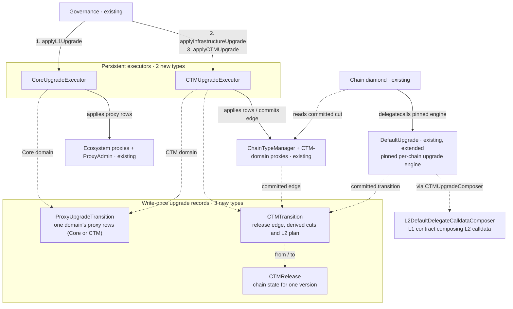
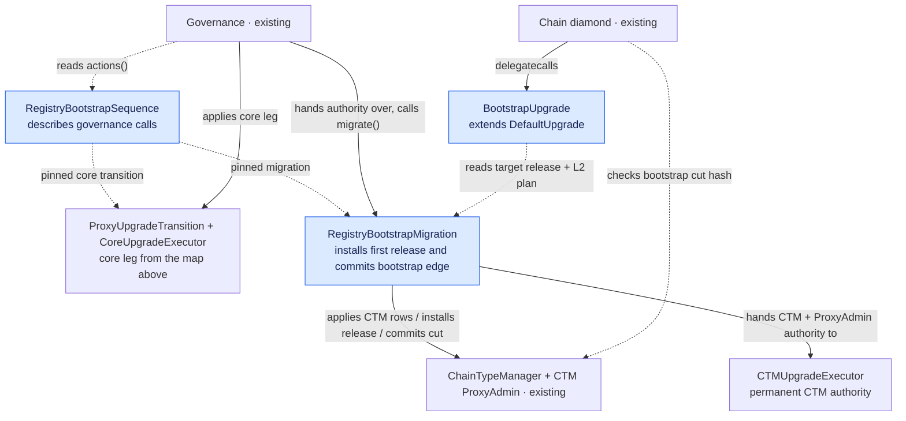
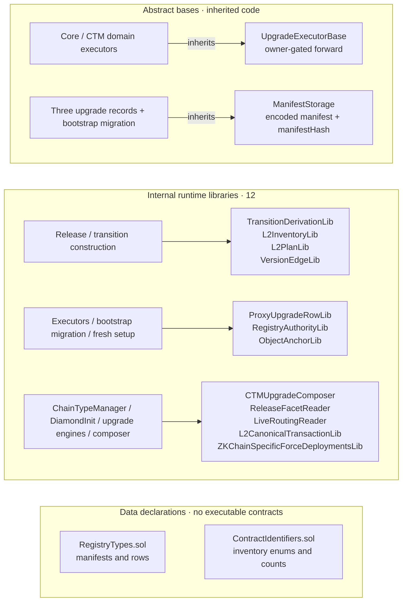
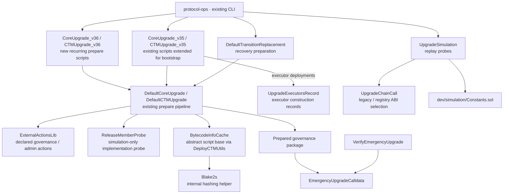

# ZKsync: Smart Contracts

[](https://zksync.io/)

ZKsync is a layer 2 rollup that uses zero-knowledge proofs to scale Ethereum without compromising on security or
decentralization. Since it's EVM compatible (Solidity/Vyper), 99% of Ethereum projects can redeploy without refactoring
or re-auditing a single line of code.

This repository contains the ZKsync smart contracts, their deployment and upgrade tooling, and the protocol
documentation they implement. It is consumed as a git submodule by the ZK Stack server and tooling repositories.

## Repository layout

| Directory                                                       | Contents                                                                                                                                 |
| --------------------------------------------------------------- | ---------------------------------------------------------------------------------------------------------------------------------------- |
| [`l1-contracts/`](./l1-contracts)                               | L1 and L2 contracts (bridgehub, bridges, chain-type manager, chain diamond, interop, ZKsync OS built-ins), Foundry deploy scripts, tests |
| [`protocol-ops/`](./protocol-ops)                               | Rust CLI that drives the Foundry scripts for ecosystem, chain, CTM and upgrade flows, and generates governance calldata                  |
| [`tools/zksync-os-genesis-gen/`](./tools/zksync-os-genesis-gen) | Generator of the ZKsync OS genesis state (the predeployed built-in contract set)                                                         |
| [`protocol-docs/`](./protocol-docs)                             | The protocol documentation — flows, motivations, security arguments — written once and referenced from the code                          |
| [`docs/`](./docs)                                               | Design documents for the repository's own machinery (registry-driven upgrades, governance self-migration, AI review guides)              |
| [`audits/`](./audits)                                           | Audit reports                                                                                                                            |
| [`environments/`](./environments), [`configs/`](./configs)      | Per-environment addresses and genesis configuration                                                                                      |

The repository is **ZKsync OS only**: EraVM chains cannot be created, upgraded or tested from it (the EraVM
workspaces, the `zksolc` toolchain and the dual-VM tooling were removed). Audited legacy contracts are kept where
live ecosystems still depend on them.

## Documentation

- [`protocol-docs/`](./protocol-docs/README.md) is the single source of truth for the protocol. Start with the
  [system architecture](./protocol-docs/system/README.md); the guides for
  [deploying](./protocol-docs/ecosystem-deployment.md) and [upgrading](./protocol-docs/ecosystem-upgrade.md) an
  ecosystem sit next to it, with the flow documents (interop, atomic interop, bridging, the message root, the chain
  lifecycle). Code comments point here instead of restating it.
- [`docs/registry-driven-upgrades.md`](./docs/registry-driven-upgrades.md) describes the upgrade model: write-once
  release / transition objects, bound executors, and the one-time bootstrap edge into it.
- Working conventions for contributors and AI agents are in [`AGENTS.md`](./AGENTS.md).

## Reviewing registry-driven upgrades

Start with [the architecture](./docs/registry-driven-upgrades.md) — the objects, the executors, the
authority model and the ordered executor calls of one governance proposal — then read
[the operational policies around it](./docs/upgrade-operations.md). The
[upgrade tooling README](./l1-contracts/deploy-scripts/upgrade/README.md) explains how the
production prepare builds and submits these objects.

### New contracts and libraries

The upgrade change adds **9 production contract types**, all deployed on L1. The larger source-file
count also includes abstract bases, internal libraries, interfaces, preparation scripts and tests.
The **12 new runtime libraries have only internal/private functions**: they compile into their
callers and do not require library deployment transactions. The
[expanded architecture maps](./docs/registry-driven-upgrades.md#contract-map) also cover the
existing genesis and upgrade engines, with a separate diagram for each group of helpers.

#### Deployed contracts: recurring upgrades

Solid arrows drive an action; dashed arrows read or reference an object. Boxes marked “existing”
provide context and are not part of the 9 new contract types. This first map contains six new
types; the bootstrap map below adds the other three. An upgrade carries only the objects, and so
only the numbered calls, it needs.



Governance owns both executors and calls them directly, in the numbered order, within one proposal
that reverts as a whole; neither executor calls the other. Each controls its own administration
targets. The composer runs on L1 even though its output is an L2 delegate call.

#### Deployed contracts: one-time bootstrap

The three highlighted types introduce a legacy ecosystem to the registry model. The other
components appeared above or already exist. The sequence describes calls; governance executes
them as one bundle, including the core leg and authority handovers.



`BootstrapUpgrade` also exposes the inherited recurring-upgrade entrypoint; the same deployment
can serve later transitions, or later releases can use `DefaultUpgrade` directly. Each legacy
chain's admin supplies its bootstrap cut separately; the chain checks it against the CTM's
committed hash before executing it.

#### Shared runtime code

These are source dependencies, not additional protocol deployments. Each helper is listed once;
arrows group its callers rather than drawing every Solidity import.



The [complete helper index](./docs/registry-driven-upgrades.md#supporting-libraries) links each
library to its implementation. `ObjectAnchorLib` checks code existence; it does not prove code
provenance. Interfaces and data types add no deployed instances.

<details>
<summary>Preparation tooling and interface inventory</summary>

The following contracts run in Forge/CLI preparation or simulation, rather than being deployed
as protocol components. Existing preparation entrypoints are marked explicitly.



Tooling sources: [prepare helpers](./l1-contracts/deploy-scripts/upgrade/default-upgrade/),
[v36 scripts](./l1-contracts/deploy-scripts/upgrade/v36/),
[emergency tooling](./l1-contracts/deploy-scripts/upgrade/EmergencyUpgradeCalldata.s.sol),
[executor records](./l1-contracts/deploy-scripts/utils/UpgradeExecutorsRecord.sol),
[chain-call adapter](./l1-contracts/deploy-scripts/utils/UpgradeChainCall.sol),
[bytecode helpers](./l1-contracts/deploy-scripts/utils/bytecode/), and
[simulation](./l1-contracts/dev/simulation/). The probe and its temporary implementation are never
broadcast. New tooling libraries also use only internal/private functions.

| Interface group            | New declarations                                                                                                                |
| -------------------------- | ------------------------------------------------------------------------------------------------------------------------------- |
| Objects                    | `ICTMRelease`, `ICTMTransition`, `IProxyUpgradeTransition`, `ICommittedUpgrade`, `IManifestHash`, `IL2DelegateCalldataComposer` |
| Executors                  | `IUpgradeExecutorBase`, `ICoreUpgradeExecutor`, `ICTMUpgradeExecutor`                                                           |
| Bootstrap                  | `IBootstrapUpgrade`, `IRegistryBootstrapMigration`, `IRegistryBootstrapSequence`                                                |
| Existing-contract adapters | `ILegacyChainTypeManager`, `ISelfDescribingFacet`, `IProxyUpgradeInitializable` (declared in `IUpgradeInit.sol`)                |
| Script-only                | `ICoreUpgradePrepare`, `ICTMUpgradePrepare` (in `IUpgradePrepare.sol`), `IAdminWithCut` (in `UpgradeChainCall.sol`)             |

The 15 runtime interfaces and two runtime data files are separate from the 14 tooling source
files above. Test fixtures and mocks are omitted from the runtime diagrams; they exercise these
same components rather than adding protocol deployments.

</details>

The current branch includes the following review surfaces:

| Review area                     | Implementation and evidence                                                                                                                                                                                                                                                                                                                                                                                                                                                                                                                                                                                                                   |
| ------------------------------- | --------------------------------------------------------------------------------------------------------------------------------------------------------------------------------------------------------------------------------------------------------------------------------------------------------------------------------------------------------------------------------------------------------------------------------------------------------------------------------------------------------------------------------------------------------------------------------------------------------------------------------------------- |
| Upgrade description             | [RegistryTypes](./l1-contracts/contracts/upgrades/registry/RegistryTypes.sol): releases, transitions, proxy upgrade transitions, proxy rows and L2 plan inputs.                                                                                                                                                                                                                                                                                                                                                                                                                                                                               |
| Execution and recovery          | [CoreUpgradeExecutor](./l1-contracts/contracts/upgrades/registry/executors/CoreUpgradeExecutor.sol), [CTMUpgradeExecutor](./l1-contracts/contracts/upgrades/registry/executors/CTMUpgradeExecutor.sol) and [bundle tests](./l1-contracts/test/foundry/l1/unit/concrete/Upgrades/registry/UpgradeBundleExecution.t.sol): one governance proposal calls the domain entrypoints in canonical order — ecosystem rows, CTM rows, transition commit — each verified, all reverting together; [domain tests](./l1-contracts/test/foundry/l1/unit/concrete/Upgrades/registry/CTMExecutorDomains.t.sol) cover per-CTM binding and executor succession. |
| Separately administered proxies | [ProxyUpgradeRowLib](./l1-contracts/contracts/upgrades/registry/libraries/ProxyUpgradeRowLib.sol): source-checked rows applied through each executor's bound ProxyAdmin (the ServerNotifier after its one-time handover) and verified in the transaction that applies them.                                                                                                                                                                                                                                                                                                                                                                   |
| L2 and bootstrap payloads       | [CTMUpgradeComposer](./l1-contracts/contracts/upgrades/registry/libraries/CTMUpgradeComposer.sol), [L2DefaultDelegateCalldataComposer](./l1-contracts/contracts/upgrades/L2DefaultDelegateCalldataComposer.sol), and [RegistryBootstrapMigration](./l1-contracts/contracts/upgrades/registry/bootstrap/RegistryBootstrapMigration.sol).                                                                                                                                                                                                                                                                                                       |
| Individual-contract changes     | [RegistryIndividualUpgrade tests](./l1-contracts/test/foundry/l1/unit/concrete/Upgrades/registry/RegistryIndividualUpgrade.t.sol): facet-only, verifier-only and validator-timelock-only upgrades assert that unrelated state is unchanged.                                                                                                                                                                                                                                                                                                                                                                                                   |
| Production proposal generation  | [v36 prepare scripts](./l1-contracts/deploy-scripts/upgrade/v36): the merge derives each upgrade's executor legs, in canonical order, from the objects the prepares deploy; other actions must be declared in the output.                                                                                                                                                                                                                                                                                                                                                                                                                     |

Security review should focus on the full authority and execution path:

- Check the source and target release/version edges, proxy identities, implementation addresses,
  initialization behavior, and the code of each upgrade engine and L2 delegate/composer.
- Check every declared external action, and verify the package with
  `protocol-ops ecosystem verify-bootstrap` for the bootstrap or `verify-package` for recurring upgrades
  before a vote.
- Check that the proposal carries every leg the upgrade needs, in canonical order: no contract ties
  the legs together. Review governance's recovery powers (`forward`, `replaceUpgradeTransition`,
  executor succession) alongside them.
- Execution checks the applied L1 state. It does not prove that every chain has completed its L2
  upgrade. Bytecode publication checks likewise do not establish the safety of the bytecode.

The [script-retirement plan](./docs/upgrade-script-retirement.md) tracks the remaining tooling
consolidation.

## Building and testing

The repository builds and tests with upstream Foundry. The pinned version is the single source of truth in
[`.github/foundry-versions.env`](./.github/foundry-versions.env); install it with:

```bash
curl -L https://foundry.paradigm.xyz | bash
foundryup --install "$(. .github/foundry-versions.env && echo "$FOUNDRY_VERSION")"
```

Then, from the repository root:

```bash
yarn build-all-contracts   # l1-contracts artifacts
yarn l1 test:foundry       # l1-contracts Foundry suite
yarn lint:check            # Solidity, TypeScript, Markdown, prettier and docs-anchor lints
```

Generated artifacts (`AllContractsHashes.json`, `l1-contracts/zkstack-out`, `l1-contracts/selectors`, the anvil
chain states) are checked in CI against the sources; see `AGENTS.md` for how to regenerate them. The end-to-end
upgrade and interop tests run on local Anvil chains from `l1-contracts/test/anvil-interop`.

## Contributing and security

See [CONTRIBUTING.md](CONTRIBUTING.md) for contribution guidelines and [SECURITY.md](SECURITY.md) for how to report
vulnerabilities (bug bounty on Immunefi).

## License

ZKsync contracts are distributed under the terms of the MIT license.

See [LICENSE-MIT](LICENSE-MIT) for details.

## Official Links

- [Website](https://zksync.io/)
- [GitHub](https://github.com/matter-labs)
- [ZK Credo](https://github.com/zksync/credo)
- [Twitter](https://twitter.com/zksync)
- [Twitter for Devs](https://twitter.com/zkSyncDevs)
- [Discord](https://discord.gg/zksync)
- [Mirror](https://zksync.mirror.xyz/)

## Security Disclaimer

ZKsync has been through lots of testing and audits. Although it is live, it is still in alpha state and will go
through more audits and bug bounties programs. We would love to hear our community's thoughts and suggestions about it!
It is important to state that forking it now can potentially lead to missing important security updates, critical
features, and performance improvements.
