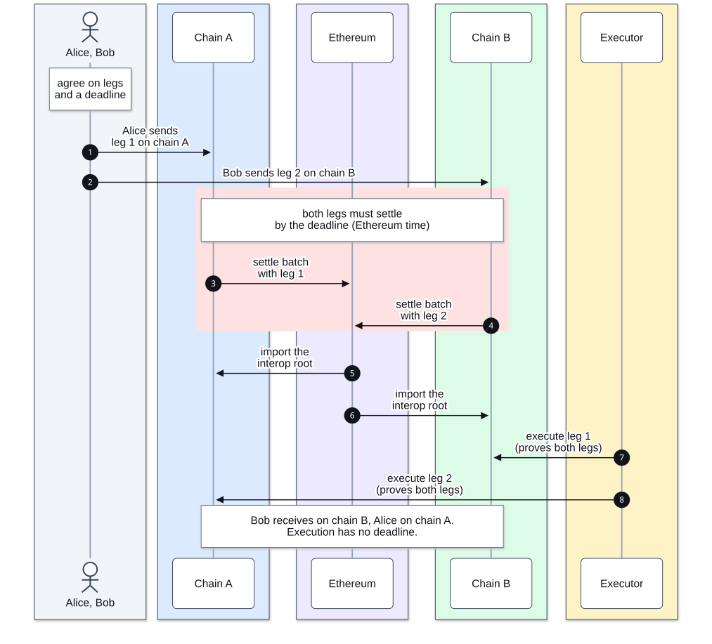

# Private Atomic Interop

Private Atomic Interop lets accounts on different ZKsync chains complete one trade together. The trade is
split into **legs**, each sent from its own chain, and the whole trade is a **flow** with one **deadline**. If
every leg reaches Ethereum by the deadline, every leg can be delivered. If any leg is late or missing, the
legs that were sent can be refunded.

It is available in ZKsync v33, between registered ZKsync OS chains that settle directly on Ethereum.
Prividium chains can take part too. To learn more, [talk with the Prividium team](https://prividium.com/contact).

You can use it for cross-chain swaps, delivery versus payment of tokenized assets, deals of up to eight
legs, or a single call to another chain.

## How a swap works

Alice on chain A and Bob on chain B swap tokens.

1. Alice and Bob each send their leg on their own chain (arrows 1 and 2). Each chain takes the tokens and
   records the leg.
2. Both chains settle their batches on Ethereum by the deadline (3 and 4). The flow is now finalized.
3. Each chain imports Ethereum's latest interop root, its record of settled batches (5 and 6).
4. An executor, which can be any account unless the leg restricts it, submits each leg on its destination
   with proof that both legs made the deadline (7 and 8). The destination checks the proofs and delivers the tokens.

If a leg misses the deadline, no leg can be delivered, and each sent leg can be refunded on the chain it
came from.

## What makes it different

No contract on Ethereum coordinates the trade. Ethereum only keeps its usual record of every chain's settled
batches; each destination chain imports that record and checks the proofs itself.

No third party holds the funds in between. Each chain's own contracts take a leg's funds when it is sent,
and release them on delivery or refund.

The trade's contents stay off Ethereum. Interop adds at most one hash per leg there, and who can read the
details is up to the chains involved.

## Next steps

- [Flows](01-flows.md): the swap in detail, plus calls, token transfers and refunds.
- [Tutorial](02-tutorial.md): run a call, a refund and a swap on two local chains.
- [Reference](03-reference.md): contracts, arguments and answers to common questions. Read
  [Safety](03-reference.md#safety) before you ship.
