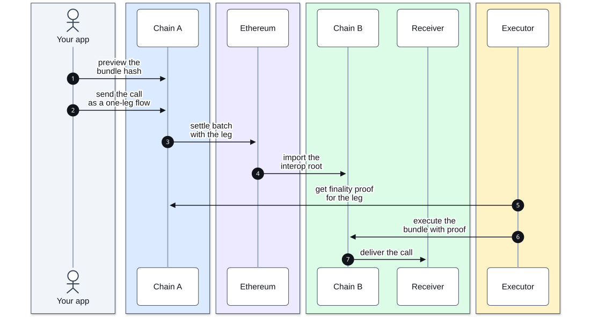
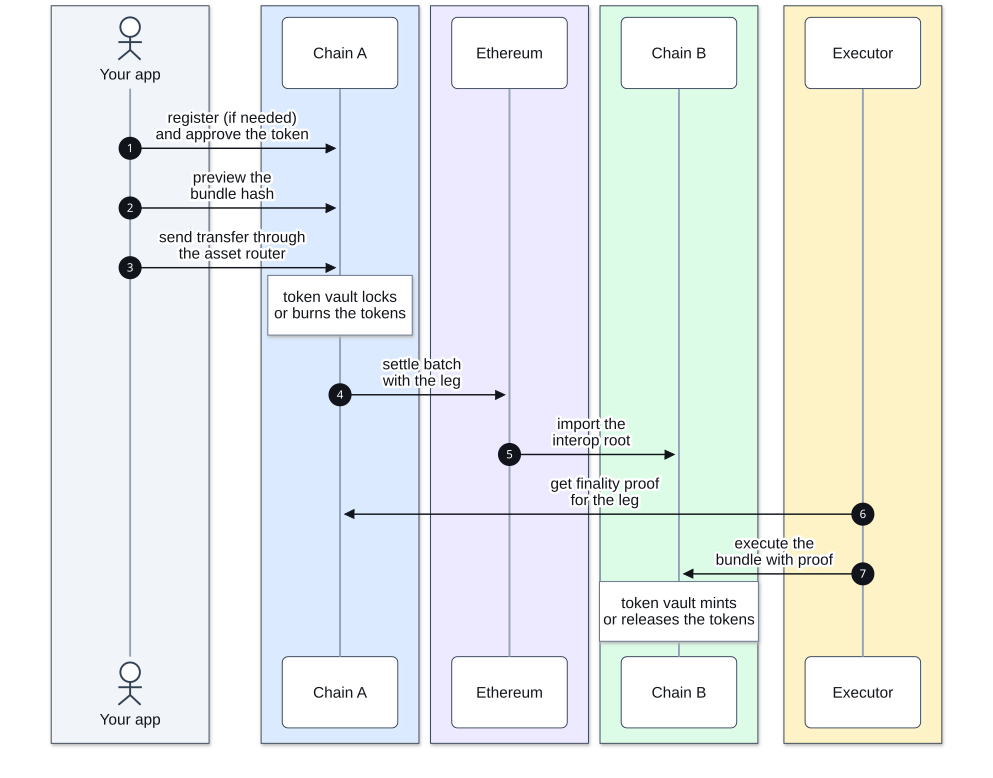
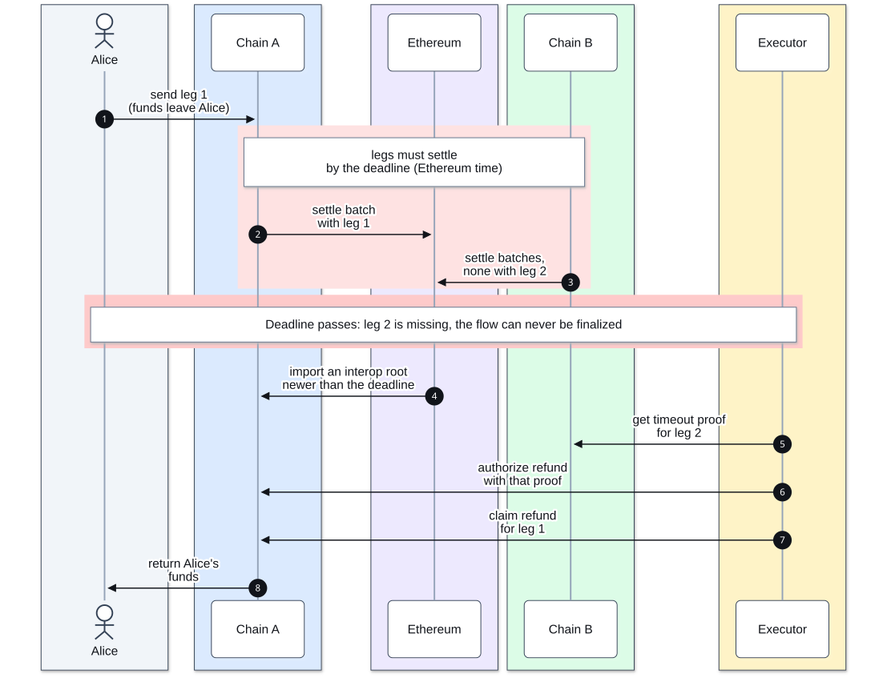

# Flows

Every flow follows the steps in [How a swap works](00-overview.md#how-a-swap-works). This page shows what
each kind of flow needs from you.

## Atomic swap

Two parties swap tokens. Each sends one leg with the same flow definition, and neither leg can be delivered
unless both settle in time.

Before anyone sends:

1. Agree on both legs (token, amount, receiver) and a deadline that leaves both chains time to settle.
2. Build each leg with its receiver as `unbundlerAddress`, the recommended setting for swaps (see
   [Leg settings](03-reference.md#leg-settings)).
3. Rebuild the other party's leg from the agreed terms and preview its hash yourself (an `eth_call` to
   `previewBundleHash` from their address on their chain). If it matches the hash they gave you, their leg
   is exactly what you agreed: same calls, amounts, receiver and settings.
4. Build the same flow definition from both bundle hashes.

Then each party sends its leg with `InteropCenter.sendBundle`. Any account can deliver each leg with
`L2InteropHandler.executeAtomicBundle`, passing a proof for both legs. That is safe by design: an executor
can only deliver a leg exactly as its sender built it, and only once the proofs show the flow is finalized.
Delivery doesn't wait for the deadline: once the flow is finalized, execute your incoming leg.

## Cross-chain call

A single call is a one-leg flow. Send it with `InteropCenter.sendMessage`. On chain B, `L2InteropHandler`
calls `receiveMessage` on your receiver contract.

The call can carry base-token value, which your receiver gets as `msg.value`, like any payable call. Use
it to pay for what the call does on chain B, or to fund an account there. It is also the only way to move
chain B's own base token, which the asset router can't deliver.

Your receiver must check who is calling it. See [Safety](03-reference.md#safety).

If the receiver reverts, the call stays executable and can be retried; a finalized flow has no refund.
Details are in the [Reference](03-reference.md#cross-chain-calls).

## Token transfer

A token transfer is one call to `L2AssetRouter`, a system contract on every ZKsync chain. On chain B, the
asset router acts as the receiver and pays the tokens out to the address in the call data, which can be any
account.

Before sending, get the token's asset ID from `L2NativeTokenVault.assetId(token)` (if it is zero, register
the token with `registerToken`), and approve the token vault for the amount. The exact call is in the
[Reference](03-reference.md#token-transfers), and the tutorial's `swap.ts` builds it in `tokenTransferCall`.

On chain A, the token vault locks the tokens, or burns them if they are a bridged copy. On chain B, it
releases them, or mints a bridged copy.

## When a leg misses the deadline

The flow times out: no leg can be delivered, and each sent leg can be refunded on its source chain. Any
account can do it, and the funds always go back to the original sender.

1. Once the source chain has imported an interop root created after the deadline, call
   `AtomicFlowManager.authorizeRefund` with a timeout proof for the missing leg. Do this once per source
   chain.
2. Call `AtomicFlowManager.claimRefund` once for each leg sent from that chain.

Tokens and base-token value come back. The interop fee and gas don't. Once a flow is finalized, refunds are no
longer possible. If a leg is never executed (nobody submits it, or its call keeps failing), its funds stay
where they are, so make sure every leg gets delivered.
