# Reference

## Architecture

The L2 contracts are system contracts at the same address on every ZKsync OS chain.

| Contract | Address | Role |
|---|---|---|
| `InteropCenter` | `0x000000000000000000000000000000000001000d` | Previews and sends legs: `previewMessageHash`, `previewBundleHash`, `sendMessage`, `sendBundle`. |
| `L2InteropHandler` | `0x000000000000000000000000000000000001000e` | Executes legs and delivers their calls: `executeAtomicBundle`, `bundleStatus`. |
| `AtomicFlowManager` | `0x0000000000000000000000000000000000010014` | Tracks legs and handles refunds: `legState`, `authorizeRefund`, `claimRefund`. |
| `L2AssetRouter` | `0x0000000000000000000000000000000000010003` | Target of every token transfer. |
| `L2NativeTokenVault` | `0x0000000000000000000000000000000000010004` | Holds, burns and mints tokens: `assetId`, `registerToken`. |

### Registering chains

A chain accepts a leg only if the destination, and the source chain of every other leg in the flow, are
registered on it. In a three-chain flow, each chain needs the other two.

On Ethereum, `ChainRegistrationSender.registerChain(chainToBeRegistered, chainRegisteredOn)` registers one
chain on another. Anyone can call it, once per pair. Both chains must settle on the same layer, and the
chain being registered must already have a settled batch.

## Flow definition

A leg carries a **bundle**, the list of calls it makes on its destination. The flow definition
(`preimage` in the contracts) has five fields:

| Field | Value |
|---|---|
| `version` | `0x01` |
| `deadline` | Ethereum timestamp |
| `settlementLayerChainId` | The Ethereum chain ID |
| `legBundleHashes` | The legs' bundle hashes, strictly ascending; 1 to 8 legs |
| `legSourceChainIds` | Each leg's source chain ID, in the same order |

The flow ID is `keccak256(abi.encode(preimage))`.

## Building and sending a flow

1. Pick a fresh salt for each leg (`interopBundleSalt`), to make its bundle hash unique.
2. Preview each bundle hash with an `eth_call` to `previewMessageHash` or `previewBundleHash` on the leg's
   source chain, from the sending account, with approvals and balances in place. The call reverts with
   `InteropPreviewHash(bundleHash)`; decode the hash from the revert.
3. Build the flow definition from all the hashes.
4. Send each leg with the same inputs plus the `atomicBundle` attribute, which carries the flow definition
   and an insertion hint. It goes in `attributes` for `sendMessage` and in `bundleAttributes` for
   `sendBundle`.

The insertion hint is the index of the source chain's commitment-tree entry with the largest value below
the leg's commit value,
`uint256(keccak256(abi.encode(bytes4(keccak256("AtomicInterop.commit.v1")), flowId, bundleHash)))`. A v33
server returns it from `zks_getImtLowNullifierIndex`.

To check another party's leg, preview it from their address on their chain. A matching hash means the leg
is what you checked, including its `unbundlerAddress` and `executionAddress`.

## Leg settings

Two optional bundle attributes decide who can act on a leg after it is sent. Both are ERC-7930 addresses.

| Setting | If unset | Recommended |
|---|---|---|
| `executionAddress` | Any account can execute the leg | Leave it unset. An executor can only deliver the leg as its sender built it, once the proofs check out, so anyone, including a relayer, can finish the flow. |
| `unbundlerAddress` | The sender, on the source chain | In a swap, the leg's receiver, on the destination chain. See [Safety](#safety). |

## Executing and refunding

- `executeAtomicBundle(bundle, {flow: {flowId, preimage}, proofs})`, where `bundle` is
  `abi.encode(interopBundle)` from the source chain's `InteropBundleSent` event, with one finality proof
  per leg in `legBundleHashes` order. Any account can call it, unless the leg sets `executionAddress`.
- `verifyAtomicBundle` takes the same arguments and checks the proofs without running the leg. After it,
  the leg's unbundler can run or cancel the leg's calls one at a time with `unbundleBundle`, for example to
  skip a call that always reverts.
- `authorizeRefund({flowId, preimage}, missingLegIndex, timeoutProof)`, once per source chain after the
  deadline, where `missingLegIndex` is the missing leg's position in `legBundleHashes`.
- `claimRefund(flowId, bundle)`, once per leg.

Store the flow definition and each leg's bundle bytes when you send. All three calls need the flow
definition, and `executeAtomicBundle` and `claimRefund` also need the bundle bytes.

## Getting proofs

A ZKsync OS server with v33 support (release v0.23.1 or later) returns proofs ready to pass on-chain. Ask
the leg's source chain, using the leg's commit value:

| Method | Returns | Call it |
|---|---|---|
| `zks_getImtInclusionProof(commitValue, blockNumber)` | The finality proof for a leg | After the batch that holds the send block (`blockNumber`) is executed on Ethereum |
| `zks_getImtNonInclusionProof(commitValue, batchNumber)` | The timeout proof for a missing leg | For a batch settled after the deadline, once it is executed on Ethereum |
| `zks_getImtLowNullifierIndex(commitValue, blockNumber)` | The insertion hint for sending a leg | Before you send |

A proof comes back as `null` if the leg isn't in that batch (inclusion) or is in it (non-inclusion). It
has the fields of the on-chain `ImtProof` except `sourceChainId`, which you add, plus
`settlementBlockNumber`. Before you submit the proof, wait until the chain you submit it to has imported
the interop root of that Ethereum block: `L2InteropRootStorage.interopRoots(ethereumChainId,
settlementBlockNumber)` at `0x0000000000000000000000000000000000010008` returns a non-zero root.

## Cross-chain calls

Send with `sendMessage(recipient, payload, attributes)`. `recipient` is an ERC-7930 address: the
destination chain plus the receiver. Add `interopCallValue` to `attributes` to send value.

Your receiver implements ERC-7786
`receiveMessage(bytes32 receiveId, bytes sender, bytes payload) payable returns (bytes4)` and returns its
selector. It should accept calls only from `L2InteropHandler`, and check the chain and account in `sender`,
an ERC-7930 address.

## Token transfers

Get the asset ID with `L2NativeTokenVault.assetId(token)`; if it is zero, call `registerToken(token)`.
Approve the token vault for the amount. Then `sendBundle(destination, calls, bundleAttributes)` with one call
to `L2AssetRouter`, given as an ERC-7930 address with no chain, carrying the `indirectCall(0)` attribute and
the data `0x01 ++ abi.encode(assetId, abi.encode(amount, receiver, token))`.

Zero amounts and fee-on-transfer tokens are rejected. The asset router can't deliver the destination
chain's own base token; send it as `interopCallValue` on a call instead.

## Fees

The sender pays an interop fee, `interopProtocolFee`, per call in the source chain's base token. Read it
right before sending, because `msg.value` must match exactly. With the same base token on both chains,
`msg.value` is the fee plus any call value. With different base tokens, `msg.value` is only the fee: the
call value is taken from your balance of the destination's base token on the source chain, so approve the
token vault for it first. The executor pays gas on the destination, and whoever submits
a refund pays its gas.

## What is visible to whom

| Who | Sees |
|---|---|
| Readers of the source chain | The full leg, and the flow definition (bundle hashes, chain IDs and the deadline) |
| Readers of the destination chain | The leg executed there and the flow definition |
| Ethereum | From interop itself, at most one hash per leg |

Anyone can read a public chain, and a private chain decides who can read it. A rollup also publishes its
state changes on Ethereum.

## Safety

- **Protect your incoming leg.** A leg's unbundler can cancel its delivery once the flow is finalized, and
  nothing is refunded. By default, the unbundler is the sender, so in a swap the other party could let your
  leg pay them and then cancel the leg that pays you. Set each leg's `unbundlerAddress` to its receiver on
  the destination chain, so only the party being paid can cancel it, and check the other party's leg before
  you send yours.
- **Check who calls your receiver.** Anyone can call `receiveMessage` directly with made-up arguments. Accept
  calls only from `L2InteropHandler`, which calls it only after checking the proofs. Then check that `sender`,
  the source chain and account, is one you expect: any account on a registered chain can send your receiver
  a call.
- **Someone must execute each leg.** Delivery isn't automatic.
- **A failed call in a finalized flow isn't undone.** The leg stays executable until a retry succeeds, or its
  unbundler runs the other calls one at a time. Test receivers beforehand.
- **Refunds must be claimed, and can fail.** A sender that can't accept the returned funds, such as a
  contract without a way to receive the base token, can't be refunded.

## Common questions

**How long does a flow take?** Mostly as long as the source chains take to finalize a batch on Ethereum. A
leg can be executed once each leg's batch is finalized and the destination has imported the interop root of
the Ethereum block that finalized it.

**What if the destination chain is down?** The flow can still be finalized, because that depends only on
the source chains. Once the destination is back, any executor can submit the leg. If that chain also
sends a leg of the flow and misses the deadline, the flow times out instead. Refunds on the other chains
then need a timeout proof for its missing leg. Its server can't provide one while it's down. The proof can
still be built from the chain's data on Ethereum if its data availability setting publishes it there;
otherwise the refunds wait until the chain is back.

**How do I track a flow?** Read `legState(flowId, bundleHash)` on the source chain's `AtomicFlowManager`
and `bundleStatus(bundleHash)` on the destination's `L2InteropHandler`. The source chain's
`InteropBundleSent` event carries the full bundle.

**Can a contract send a leg?** Yes, and several legs can come from the same chain. A contract sender must be
able to accept refunds.

**Can Ethereum be a leg's destination?** No. Withdrawals to Ethereum use the same `InteropCenter` but
aren't atomic.
