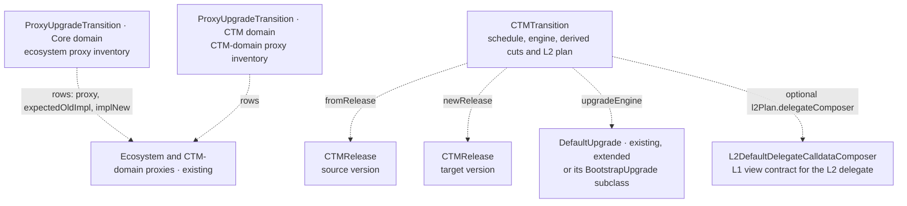
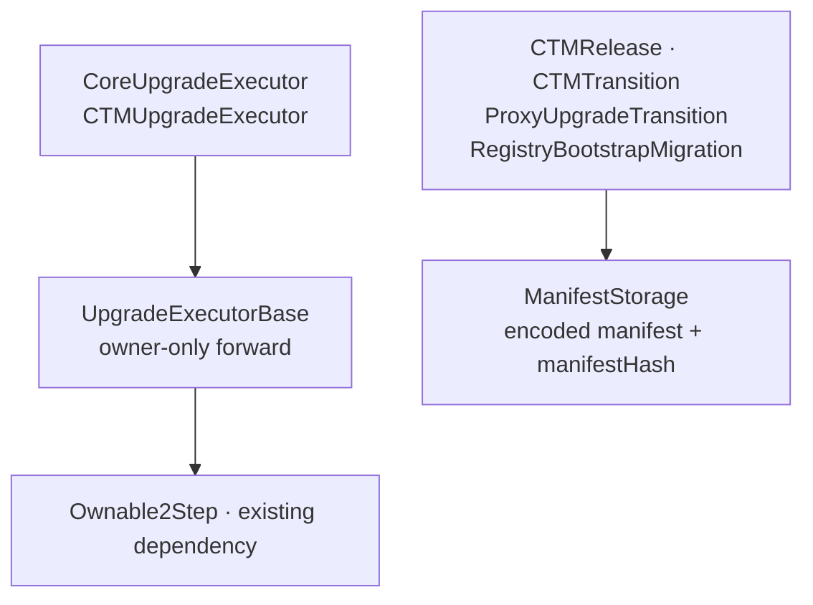
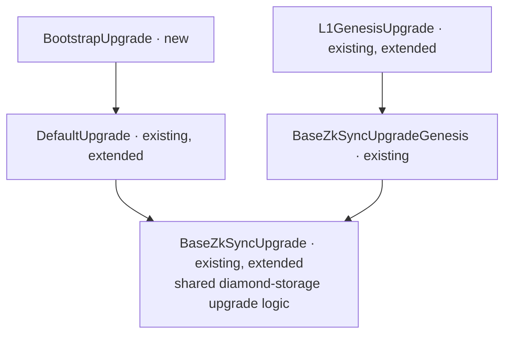
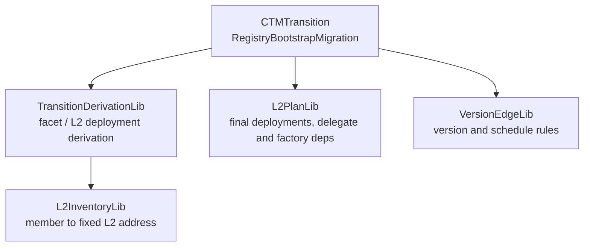
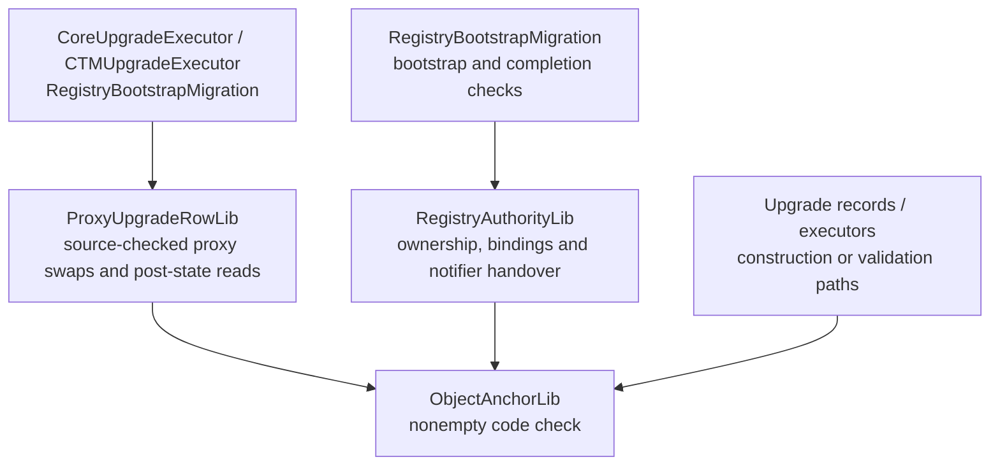
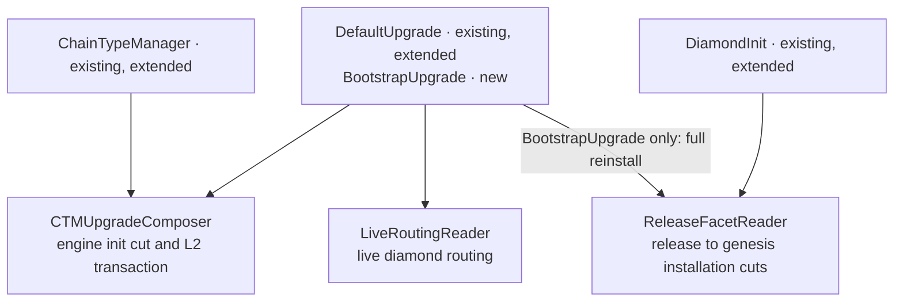
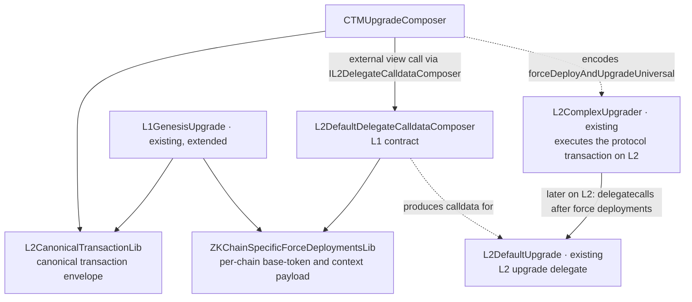
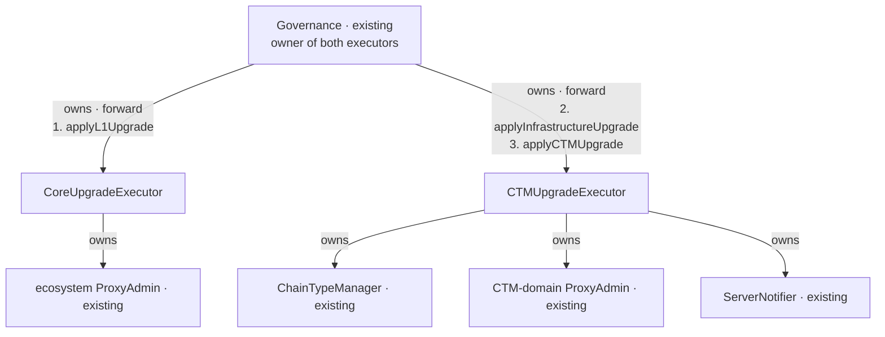
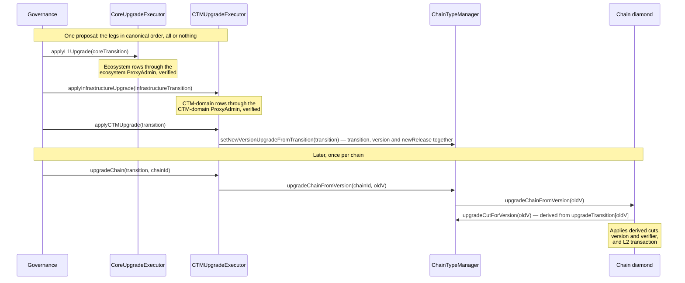
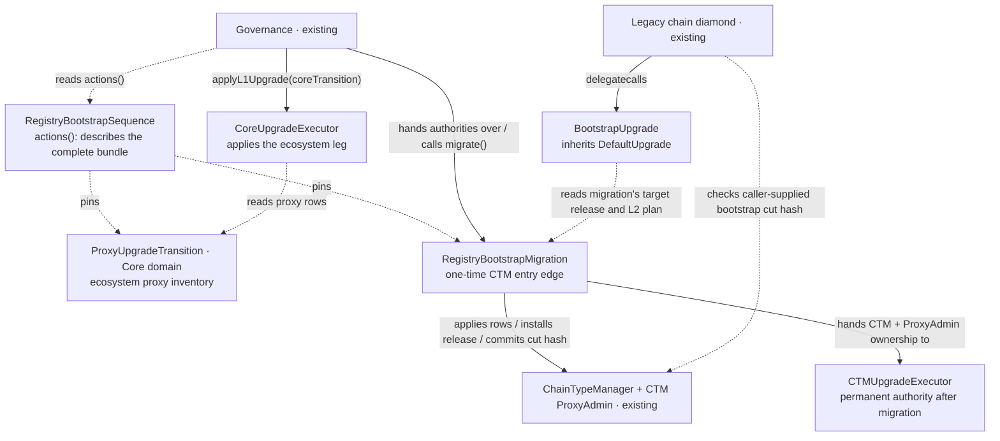

# Registry-Driven Protocol Upgrades

A protocol upgrade is a set of **write-once contracts** deployed ahead of time. Governance approves
the object addresses and the contents they commit to; the contracts validate them and the executors
apply them. What governance signs is one proposal: a fixed-signature call per object on the executor
of its domain, in a canonical order, plus whatever the prepare declared as an external action.

**Scope:** L1 + L2 era-contracts, upgrade tooling, governance proposal shape.

This is the architecture document. Two other documents complete it and are not restated here:

- [`protocol-docs/ecosystem-upgrade-coordination.md`](../protocol-docs/ecosystem-upgrade-coordination.md)
  is the **coordination spec**: what each domain executor's entrypoint does, the order governance
  calls them in within one proposal, and where ordering and atomicity are enforced.
- [`l1-contracts/deploy-scripts/upgrade/README.md`](../l1-contracts/deploy-scripts/upgrade/README.md)
  is the **runbook**: how a prepare is run, composed, verified, replayed and how chains cross.

[`upgrade-operations.md`](upgrade-operations.md) keeps the operational policies that belong to
neither: the ServerNotifier handover, executor succession, monitoring, recovery and the
incident-only migration pauses.

Start with the [contract maps](#contract-map) for the component inventory, then read
[objects](#objects), [authority](#authority), [upgrading](#flow-upgrading) and [bootstrap](#bootstrap). The central security question is whether the reviewed objects and the
declared external actions account for every executable change: review source/target edges,
target identities, the deployed code at every named address, initializers, engine and composer
code and ownership changes together, check that the proposal carries every leg the upgrade needs in
canonical order, and include governance's `forward` and executor-replacement powers. Execution
verifies the applied L1 state, not completion on every L2 chain.

## Model

Two objects, deliberately separate:

|          | **Release**                                                                                                               | **Transition**                                   |
| -------- | ------------------------------------------------------------------------------------------------------------------------- | ------------------------------------------------ |
| Answers  | what a chain **is**                                                                                                       | how release A **becomes** release B              |
| Contains | complete facet set (routing self-described by the facets), `DiamondInit`, verifier, genesis params, force-deployment data | upgrade engine, chain schedule, L2 plan          |
| Version  | the protocol version it IS — one release per version                                                                      | reads its `old -> new` edge off its two releases |
| VM flag  | none — every release is a ZKsync OS release                                                                               | —                                                |

A release is the chain state of ONE protocol version: everything a chain _runs_ belongs to it,
including the verifier (the chain stores it as `s.verifier`), and so does the version number itself.
What a release does **not** carry is anything about _when_ — the schedule is the transition's. A
transition authors no version edge: it reads it off its two releases. The CTM moves its version and
its `currentRelease` in one call on both version edges — `setNewVersionUpgradeFromTransition` installs
the transition's `newRelease`, the bootstrap's cut-taking `setNewVersionUpgrade` its genesis release —
and refuses a release of any other version, so the pointer and the version cannot come apart. A bump
that changes no member still publishes a release, differing from its predecessor in the version alone.

**A transition's facet cuts are not authored.** They are derived from its
`(fromRelease, newRelease)` pair in the constructor and stored: a full reinstall — remove the
departing release's routing, install the target's. One shortcut to an empty cut, by value: two
releases whose routing is byte-identical. Governance
reviews two releases plus the transition's own fields; the cuts are computed, not written.

A transition describes one CTM's chain-version edge and nothing else. Infrastructure changes belong
to a third object, the **proxy upgrade transition** (one per domain), which is also what makes them
separable: replacing a singleton behind a CTM-domain proxy is an upgrade with no transition at all,
and therefore costs no chain-version edge. See
[the coordination document](../protocol-docs/ecosystem-upgrade-coordination.md).

## Contract map

The upgrade change introduces **9 production contract types**, all deployed on L1. They are
two persistent executors, three write-once upgrade records, two bootstrap helpers, the bootstrap
engine and the L1 calldata composer. The larger file count also includes **two abstract bases**,
**twelve internal libraries**, **fifteen runtime interfaces** and **two data-only files**. Libraries
and inherited bases add code to their callers, rather than additional protocol deployments.

These small maps show records, authority, shared code and bootstrap separately. Existing contracts
appear as context and are marked explicitly. [The runbook](../l1-contracts/deploy-scripts/upgrade/README.md)
covers the preparation scripts and CLI commands around these contracts.

### Records and their references

Dashed arrows are reads or stored references. An upgrade carries any nonempty subset of the three
top objects and nothing links them: the governance proposal applies them in order. A transition
always names both releases.

The two release boxes are instances of the same `CTMRelease` type, and the two inventory boxes of
the same `ProxyUpgradeTransition` type, told apart by the domain in their manifests. A release names
the facets, `DiamondInit`, verifier and genesis engine it installs, together with genesis data and L2
bytecodes.
It holds no executor or authority. The engine and composer boxes show the current production
implementations; manifests pin addresses and can name version-specific implementations. The
[authority map](#authority) shows which executors consume these records; the
[bootstrap map](#bootstrap-component-map) adds the one-time migration objects.

### Inherited code

Arrows point from a caller to the base it inherits. These bases do not introduce separate deployed
instances. `ManifestStorage` stores the encoded manifest and supplies the common hash; each record
retains its own typed decoder.

The existing engine hierarchy supplies the common diamond-storage upgrade logic. Arrows again
point from a contract to its base; only `BootstrapUpgrade` is a new type in this diagram.

A deployed `BootstrapUpgrade` can serve the bootstrap and later transitions. The L2 calldata
composer implements `IL2DelegateCalldataComposer`; it is called on L1, and its output is executed
later on L2.

Interfaces and data declarations: no deployed instances

| Surface                       | New interfaces                                                                                                   |
| ----------------------------- | ---------------------------------------------------------------------------------------------------------------- |
| Executor authority            | `IUpgradeExecutorBase`, `ICoreUpgradeExecutor`, `ICTMUpgradeExecutor`                                            |
| Records and shared reads      | `ICTMRelease`, `ICTMTransition`, `IProxyUpgradeTransition`, `ICommittedUpgrade`, `IManifestHash`                 |
| Bootstrap and composition     | `IRegistryBootstrapMigration`, `IRegistryBootstrapSequence`, `IBootstrapUpgrade`, `IL2DelegateCalldataComposer`  |
| Compatibility and member APIs | `ILegacyChainTypeManager`, `ISelfDescribingFacet`, `IProxyUpgradeInitializable` (declared in `IUpgradeInit.sol`) |

`RegistryTypes.sol` defines manifests and rows. `ContractIdentifiers.sol` defines the inventory enums
and their counts; despite its directory name, it declares no library. Preparation-only interfaces
(`ICoreUpgradePrepare`, `ICTMUpgradePrepare`) and test doubles are outside this runtime inventory.

## Objects

All are storage-backed, built once from a manifest they take in the constructor, and commit
`manifestHash = keccak256(abi.encode(manifest))`. The struct definitions and their field docs are
in `l1-contracts/contracts/upgrades/registry/RegistryTypes.sol`.

| Contract                     | Holds                                                                                                                                                                                                                                                                                                                              |
| ---------------------------- | ---------------------------------------------------------------------------------------------------------------------------------------------------------------------------------------------------------------------------------------------------------------------------------------------------------------------------------- |
| `CTMRelease`                 | `diamondInit`, `verifier`, `GenesisFacet[]` (address + freezability), `fixedForceDeploymentsData`, genesis params incl. the genesis upgrade, `l2BytecodeInfos` (the `L2EcosystemContract`-indexed implementation table), one shared `l2SystemProxyBytecodeInfo` shell                                                              |
| `CTMTransition`              | version edge, `fromRelease`, `newRelease`, `upgradeEngine`, `oldProtocolVersionDeadline`, `upgradeTimestamp`, `AuthoredL2Plan`; **derived and stored:** `Diamond.FacetCut[]` and the L2 force deployments                                                                                                                          |
| `ProxyUpgradeTransition`     | its `domain` and that domain's enum-indexed inventory of `(proxy, expectedOldImpl, implNew)` rows: `Core` for the SHARED singletons (bridges, Bridgehub, MessageRoot, …), `CTM` for the CTM-domain proxies, incl. the CTM itself. One instance per changed domain per upgrade; an inventory with no participating row is rejected. |
| `RegistryBootstrapMigration` | one edge from a pre-registry CTM into this model — see [Bootstrap](#bootstrap)                                                                                                                                                                                                                                                     |

### Enum-indexed proxy inventories

Proxy upgrades are not carried as anonymous row lists. Each manifest carries a **complete row
array indexed by the canonical contract enum** — the SAME enum that identifies the contract for
deployment, one enum per domain (`ContractIdentifiers.sol`) — whose length must be exactly the
enum's member count (`L1_ECOSYSTEM_CONTRACT_COUNT` / `CTM_CONTRACT_COUNT`):

- `ProxyUpgradeTransitionManifest.proxyUpgrades` is indexed by `L1EcosystemContract` in the `Core`
  domain and by `CTMContract` in the `CTM` domain. The domain is part of the manifest, and the
  required length follows from it, never from the caller.
- `BootstrapManifest.ctmProxyUpgrades` is indexed by `CTMContract`.

In the CTM domain only the members behind a proxy under the CTM-domain `ProxyAdmin` can
participate: ChainTypeManager, ValidatorTimelock, BytecodesSupplier, PermissionlessValidator, the
ServerNotifier and the L1InteropFeeManager.

Slot `uint256(member)` IS that contract's row; a slot whose `implNew` is zero is the **"not
upgraded" statement**. The length check means every contract of the domain HAS a slot and none can
be smuggled in, and the enum — being the same one deployment uses — is the single naming scheme end
to end. `ProxyUpgradeRowLib.toRows` flattens the array into the `ProxyUpgradeRow[]` the executors
apply, dropping the inert slots, so the executors never recompile when the inventory grows.

**What the length check does not give you.** It guarantees the SLOTS exist, not that preparation
populated every intended change: an inert slot is the same bytes whether the upgrade deliberately
leaves the contract alone or whether nobody wrote its row builder. Nothing on-chain can tell those
apart — only the run that produced the deployments can. That is why preparation refuses an
implementation it deployed that no row installs and no version script named as deliberately
uninstalled (`_requireDeployedImplementationsInstalled` on both `DefaultCoreUpgrade` and
`DefaultCTMUpgrade`; `uninstalledCoreDeployments` / `uninstalledCTMDeployments` are the
declarations). A reviewer reading a manifest is reading recorded decisions, and still has to check
them against the release.

**A row has no admin of its own.** Every row is applied through the applying executor's bound
`ProxyAdmin`, which administers every proxy of its domain — the ServerNotifier included, after its
[one-time handover](upgrade-operations.md#servernotifier-a-one-time-handover-then-an-ordinary-ctm-domain-proxy).
A row under an admin the executor does not own reverts, and so does an object of the other domain
(`ProxyUpgradeDomainMismatch`): a misbound executor is a configuration error, not something to skip
past. `applyRows` re-reads every row after the swaps and reverts
unless each proxy runs its `implNew`, so execution verifies what it applied in the same transaction.

### Reinitializers: a fixed call, no data

A row never carries calldata. Its `callInitializeUpgrade` BOOLEAN is the entire reinitialization
surface: when set, the apply performs `upgradeAndCall` with the FIXED, argument-less
`IProxyUpgradeInitializable.initializeUpgrade()` selector. Everything the reinitializer needs
lives in the new implementation's own audited code — constants, or immutables on L1, both settled
by the deployment governance reviewed. A manifest cannot route the init call to an arbitrary function or
smuggle arguments into it; a wrong reinitialization value is a missing line in an audited contract
diff, never a wrong byte in offchain-authored data.

### Supporting libraries

All twelve helpers below have only internal/private functions and compile into their callers.
The maps below group their responsibilities; an arrow means “uses this code” unless labelled as an
external view call. They show representative callers, rather than every Solidity import.

| Library                                                                                                         | Role                                                                               |
| --------------------------------------------------------------------------------------------------------------- | ---------------------------------------------------------------------------------- |
| [TransitionDerivationLib](../l1-contracts/contracts/upgrades/registry/libraries/TransitionDerivationLib.sol)    | Facet cuts and L2 deployments from the source and target releases                  |
| [ReleaseFacetReader](../l1-contracts/contracts/upgrades/registry/libraries/ReleaseFacetReader.sol)              | Genesis installation from a release's self-described routing                       |
| [LiveRoutingReader](../l1-contracts/contracts/upgrades/registry/libraries/LiveRoutingReader.sol)                | Reads departing diamond routing; checks it against the source release              |
| [CTMUpgradeComposer](../l1-contracts/contracts/upgrades/registry/libraries/CTMUpgradeComposer.sol)              | Committed cut and L2 protocol transaction from a transition or bootstrap migration |
| [L2InventoryLib](../l1-contracts/contracts/upgrades/registry/libraries/L2InventoryLib.sol)                      | Maps inventory members to fixed L2 addresses                                       |
| [L2PlanLib](../l1-contracts/contracts/upgrades/registry/libraries/L2PlanLib.sol)                                | Constructs the executable L2 plan and checks bytecode publication                  |
| [VersionEdgeLib](../l1-contracts/contracts/upgrades/registry/libraries/VersionEdgeLib.sol)                      | Checks version ordering and schedule constraints                                   |
| [ProxyUpgradeRowLib](../l1-contracts/contracts/upgrades/registry/libraries/ProxyUpgradeRowLib.sol)              | Normalizes inventory rows and applies source-checked, verified proxy swaps         |
| [RegistryAuthorityLib](../l1-contracts/contracts/upgrades/registry/libraries/RegistryAuthorityLib.sol)          | Checks executor bindings, ownership and notifier handover                          |
| [ObjectAnchorLib](../l1-contracts/contracts/upgrades/registry/libraries/ObjectAnchorLib.sol)                    | Checks that an object or member has code; does not attest its provenance           |
| [L2CanonicalTransactionLib](../l1-contracts/contracts/state-transition/libraries/L2CanonicalTransactionLib.sol) | Shared construction of canonical L2 transactions                                   |
| [ZKChainSpecificForceDeploymentsLib](../l1-contracts/contracts/upgrades/ZKChainSpecificForceDeploymentsLib.sol) | Builds the per-chain base-token and context payload                                |

#### Constructing a committed edge

A transition derives its delta from two releases. The bootstrap derives its full initial L2 set
from the first release; both construct the final plan and enforce the same edge rules.

#### Applying rows and checking authority

`ObjectAnchorLib` checks that code exists. The separate
[provenance verification](#provenance-and-validation) establishes whether it is the reviewed code.

#### Diamond routing and committed cuts

These engine calls run in the chain diamond's storage through delegatecall. Recurring upgrades
check the source release's routing and apply the transition's stored cuts. The bootstrap removes
the live legacy routing and installs the first release's complete routing.

#### Composing the L2 transaction on L1

The composer reads the target release and Bridgehub to encode the L2 delegate's arguments for one
chain. It holds no chain state and executes on L1; its result is part of the L2 protocol transaction.

There is no intermediate genesis-manifest type between a build and its `ReleaseManifest`:
`DeployCTMUtils.deployCurrentRelease` (and `deployAdditionalReleaseFacets`) assembles the
`GenesisFacet[]` directly as it deploys each facet, and the release's implementation table and its
one shared `l2SystemProxyBytecodeInfo` shell come from `SystemContractsProcessing`.

## Authority

Two executors, one authority root. Governance owns both; each holds one domain's protocol
authority and answers only to its owner. Neither calls nor names the other: what ties one upgrade's
legs together is the governance proposal that calls them, in the numbered order above
([coordination spec](../protocol-docs/ecosystem-upgrade-coordination.md#execution)).

A fresh ecosystem is born in this shape. `DeployL1CoreContracts` deploys the core executor and
hands it the ecosystem `ProxyAdmin`; `DeployCTM` deploys the CTM executor bound to the CTM and the
CTM-domain `ProxyAdmin` (every CTM gets its own, even when it reuses the ecosystem's governance and
ChainAdmin), hands it the CTM, that `ProxyAdmin` and the ServerNotifier, and nominates the ecosystem
governance it reads off the core executor; `RegisterCTM` registers the CTM and binds nothing. The
scripts construct the executors for the deployer, which makes these handovers, and nominate
governance, which accepts in `protocol-ops hub init` / `ctm init`. The end state is exactly what a
completed [bootstrap](#bootstrap) leaves: `RegistryAuthorityLib.requireRegistryAuthority`, the
authority half of `RegistryBootstrapMigration.validateApplied()`, accepts both.

| Executor              | Bound to (immutable)                      | Entrypoints                                                                                                                                                                     |
| --------------------- | ----------------------------------------- | ------------------------------------------------------------------------------------------------------------------------------------------------------------------------------- |
| `CoreUpgradeExecutor` | the ecosystem `ProxyAdmin`                | `applyL1Upgrade`, `forward` (owner)                                                                                                                                             |
| `CTMUpgradeExecutor`  | one `ChainTypeManager` + its `ProxyAdmin` | `applyInfrastructureUpgrade`, `applyCTMUpgrade`, `forward` (owner); `upgradeChain` (owner, or the chain's own admin); `acceptCTMOwnership` (owner, or the nominating CTM owner) |

What each entrypoint checks is the
[coordination spec](../protocol-docs/ecosystem-upgrade-coordination.md#execution).

`UpgradeExecutorBase` gives every executor ONE role. `owner` (`Ownable2Step`) drives the fixed
entrypoints, whose inputs are write-once objects, and the same owner can `forward` raw calls — the
escape hatch that keeps the authority the executor holds reachable, every call logged as
`CallForwarded`. It has no gate of its own: routine proposals and the `EmergencyUpgradeBoard` both
reach the executor through the `ProtocolUpgradeHandler`, so no on-chain distinction between them
exists, and what guards a raw call is the owner's governance process (the handler's timelock, the
Security Council's veto, the board's quorum).

### Authority matrix after bootstrap

Who can do what once the CTM domain is owned by `CTMUpgradeExecutor`. "Chain side" is the
`onlyAdmin` / `onlyAdminOrChainTypeManager` path on the chain's own Admin facet;
`onlyChainTypeManager` methods have no such path; governance reaches them, like every CTM owner
method the executor has no entrypoint for, through the executor's owner-gated, logged `forward`.

| CTM owner method                                                                                                          | Through the executors                                                                                                                               | Chain side                              |
| ------------------------------------------------------------------------------------------------------------------------- | --------------------------------------------------------------------------------------------------------------------------------------------------- | --------------------------------------- |
| `setNewVersionUpgradeFromTransition` (installs the target release too)                                                    | `applyCTMUpgrade` (the transition governance approved)                                                                                              | —                                       |
| `upgradeChainFromVersion(chainId, oldVersion)`                                                                            | `upgradeChain`                                                                                                                                      | —                                       |
| `upgradeChainFromVersion(chainId, oldVersion, cut)` (a chain below v35, on a legacy-committed edge; to be deleted in v36) | `forward` only                                                                                                                                      | chain admin (the cut-taking entrypoint) |
| `L1ChainAssetHandler.pauseCTMMigration` / `unpauseCTMMigration` (as CTM owner; incident control)                          | `forward`                                                                                                                                           | —                                       |
| `replaceUpgradeTransition` (repair a departed version's transition)                                                       | `forward`                                                                                                                                           | —                                       |
| `setProtocolVersionDeadline`                                                                                              | `forward`                                                                                                                                           | —                                       |
| `freezeChain`, `unfreezeChain`                                                                                            | `forward`; the Bridgehub's owner also calls them directly ([freezing a chain](../protocol-docs/ecosystem-upgrade-coordination.md#freezing-a-chain)) | — (`onlyChainTypeManager`)              |
| `setValidator`, `setPriorityTxMaxGasLimit`, `deactivatePriorityMode`, `setValidatorTimelockPostV29`                       | `forward`                                                                                                                                           | — (`onlyChainTypeManager`)              |
| `revertBatches`                                                                                                           | `forward`                                                                                                                                           | validator (`revertBatchesSharedBridge`) |
| `changeFeeParams`, `setTokenMultiplier`                                                                                   | `forward` only                                                                                                                                      | chain admin                             |
| `setPendingAdmin`                                                                                                         | `forward` only                                                                                                                                      | CTM admin (`onlyOwnerOrAdmin`)          |
| `setServerNotifier` (owner only: the notifier binding is governance's)                                                    | `forward` only                                                                                                                                      | —                                       |
| `executeUpgrade` (arbitrary cut), legacy `setNewVersionUpgrade` / `setUpgradeDiamondCut`                                  | `forward` only — deliberately: the bypass the object-driven path exists to remove                                                                   | —                                       |
| CTM / ProxyAdmin `transferOwnership` (executor succession)                                                                | `forward` only                                                                                                                                      | —                                       |

The executors hold three more authorities, reached the same way outside their upgrade entrypoints:
`CTMUpgradeExecutor.forward` for the CTM-domain `ProxyAdmin` and the ServerNotifier's owner methods
(`setUpgradePreconditionChecker`, `setChainTypeManager`), and `CoreUpgradeExecutor.forward` for the
ecosystem `ProxyAdmin`. The `L1ChainAssetHandler` stays with its own owner.

## Provenance and validation

**Governance approves the exact deployed objects, and verifying them off-chain is a mandatory step
before every vote.** `protocol-ops ecosystem verify-bootstrap` re-derives each object's address from
the reviewed creation code and the arguments it was constructed with — for a write-once object, the
manifest it serves — and treats "unverifiable" as an error. Nothing on-chain attests to an object's
construction or to what its members run: the code checks on chain only prove that the contracts an
object names are deployed code.

Construction, not runtime code, is what has to be verified: creation code can write arbitrary
storage and then return whatever runtime bytecode it likes, so a contract running the audited
runtime code proves only that — never that the audited CONSTRUCTOR produced the state that code
reads. A `CTMTransition` derives its facet cuts and L2 plan at construction and every chain applies
those cuts by delegatecall; a counterfeit built from adversarial creation code could serve the
approved manifest, pass `validate()` and still route security-critical selectors wherever its author
chose. Objects therefore carry no codehash of themselves or of their members: a hash supplied
beside the address it describes can only agree with itself.

The verification answers three questions for every object a package names:

1. **Was it PRODUCED by the reviewed code's constructor, from its reviewed arguments?** Every
   object is deployed through the deterministic CREATE2 factory (`0x4e59…4956C`), so
   `address == keccak256(0xff ++ factory ++ salt ++ keccak256(creationCode ++ abi.encode(args)))[12:]`.
   For a write-once object the arguments are the manifest it serves: the verifier reads it off the
   object, re-encodes it, and recomputes that address from the reviewed creation code. For both
   domain executors and the bootstrap sequence, the arguments are the ones each was constructed
   with (an executor's as its record states them, below): the initial owner, the ecosystem
   `ProxyAdmin`, the CTM and its `ProxyAdmin`; the sequence's migration and core transition.
   Never the object's own getters: a genuine executor built for an attacker's owner answers every
   getter like the reviewed one. What legitimately moves after construction — the current owner
   and a pending nomination — is checked live against the reviewed governance. A match proves the
   canonical constructor ran on those arguments, which covers the object's WHOLE state —
   immutables, storage and derived fields. The creation-code BYTES come from the local build
   (`l1-contracts/out`), held against the committed `evmBytecodeHash`, so a doctored build
   directory cannot pass. The salt is per prepare leg (the
   core prepare's `[contracts] create2_factory_salt`, each CTM prepare's `[create2_factory_salts]`
   entry); each prepare records the one it deployed under (`create2_factory_salt`), a reviewer may
   add more, and every object is tried under each. The executors outlive the run that deployed them, so that run — `ecosystem init`,
   `ctm init` or the bootstrap prepares — records each one's salt and ORIGINAL constructor
   arguments in its output (`[upgrade_executors]`); a later package is verified against that
   record (`--executor-record`), so an executor whose owner has legitimately moved since still
   re-derives. The record is mandatory: an executor without one is unverified.
2. **Does it — and does every member it names — run the reviewed code?** The live code against the
   reviewed build's deployed bytecode of the contract its role admits, byte for byte outside the
   artifact's immutable slots, the build held against `AllContractsHashes.json`. For a write-once
   object that is beside question 1; the executors, whose bindings are immutables, rest on
   question 1 alone. For the MEMBERS — a release's facets, `DiamondInit`, genesis upgrade and
   verifier tree, each engine and composer, each row's `implNew`, and on L2 each bytecode info a
   release's table or a transition's plan names (against the reviewed `(blake2s, length,
keccak256)`) — it is the identity check, which proves their code but not the values their
   constructors wrote into the masked slots. Those come from question 1 applied to the members:
   every prepare records each contract it deploys (`[member_deployments]`: contract, factory, salt,
   constructor arguments), and each L1 member a package NEWLY installs — including the
   implementation behind a proxy the package introduces, a proxy that must run the reviewed
   `TransparentUpgradeableProxy` with the CTM-domain `ProxyAdmin` in its EIP-1967 admin slot — is
   re-derived from its record and the reviewed creation code, and each recorded argument is held against the live source the prepare
   read it from (the L1 chain id, the Bridgehub and the proxies discovered through it, the chain
   cap, the asset router's WETH token and owner, the rollup DA manager of a chain on the CTM, the
   CTM's own immutables, the sub-verifiers the walk read) or the env's permanent values
   (`testnet_verifier`), never against anything the package supplies. The Bridgehub is the
   reviewer's (the env's `bridgehub_proxy_addr`, or `--expected-bridgehub`); the package's CTM and
   `bridgehub_proxy_addr` must agree with it. A member the departing release (or, at the bootstrap,
   the verifier the chains run, with its tree) already names was reviewed when it was installed and
   is not re-derived. A release may carry over the verifier already in force where it departs
   from, which an earlier build produced. `ZiskVerifier`'s snarkJS Plonk backend is built outside
   this repository, so it is held to the runtime codehash pinned in
   `tools/verifier-gen/data/ZiSK_plonk_backend.toml` instead. Every proxy row must also name the
   proxy of its slot, discovered on chain from the Bridgehub or the CTM. Code the build does not
   produce for the role is a finding.
3. **Do the governance calls execute those objects, and nothing else?** For an upgrade the bundle
   carries the executor legs its objects need, each re-encoded from the reviewed executor and
   object, exactly once and as one contiguous run in canonical order (core, CTM infrastructure, CTM
   transition); every other call is a declared external action, and none may reach the executors,
   the objects, the CTM or either `ProxyAdmin`. For the bootstrap
   edge the bundle carries the run the construction-verified `RegistryBootstrapSequence` derives,
   contiguous and in order, and every other call must be a declared external action to a target
   OUTSIDE the edge's authorities: a call to the CTM, a `ProxyAdmin`, an executor or an object
   beyond the derived run — a `transferOwnership` nomination appended after the
   legitimate calls, say — is an error whether the package declares it or not. On chain,
   `RegistryBootstrapMigration.validateApplied()` refuses a pending nomination on every
   `Ownable2Step` authority the edge lands on or drives, for the same reason.

The tool's full checklist, including what it deliberately does not check, is in
[`ai-review/docs/protocol-ops.md`](ai-review/docs/protocol-ops.md).

Its limits, stated so they are not mistaken for coverage: the salt is a package input, so an
attacker free to choose both a salt and a counterfeit deployment faces the standard ~2^80 CREATE2
address-collision bound rather than a 160-bit preimage; the derivation binds an object to its
MANIFEST, never to what the manifest's members RUN — a genuine object built from a manifest naming
an attacker's facet verifies perfectly, which is why question 2 holds every member to the reviewed
build; the values in a CARRIED-OVER member's immutable slots are the ones an earlier review
accepted (or none, for a release `ctm init` deployed), not re-checked here; and a proxy a package
introduces is held to its code, admin and implementation, not to the `initialize` calldata its
constructor ran. The first two
boundaries are pinned by
`test/foundry/l1/upgrades/CounterfeitObject.t.sol`, which builds an actual counterfeit from real
initcode and asserts the derivation rejects it.

For this to hold, manifest data must live in **storage**, never in immutables: immutables are
patched into runtime code, which would make an object's runtime bytes depend on its manifest and
break question 2.

**Members are named by address.** Everything executable an object names — facets, `DiamondInit`,
the verifier, the genesis upgrade, the upgrade engine, the composer, each `implNew` — is
an ADDRESS; what it runs is held to the reviewed build off chain (question 2), never on chain.

**What the chain enforces**, on every path:

- `ObjectAnchorLib.requireCode` on every object and every member an object names. Not bookkeeping:
  a call to a codeless address SUCCEEDS silently, and a codeless delegatecall target turns a
  chain's upgrade into a no-op that reports success.
- `validate()` on each release and transition where it is built over, committed or installed
  (transition construction for both release edges, the CTM's commit and replacement, `migrate()`),
  and a code check on every proxy row's `implNew` before the first swap
  (`ProxyUpgradeRowLib.applyRows`, for `applyL1Upgrade`, `applyInfrastructureUpgrade` and
  `migrate()`). Two paths deliberately skip it and say so in code: the per-chain `upgradeChain`
  and the engine's `upgradeFromTransition` execute only the transition the CTM already committed,
  whose members cannot have lost their code since.
- The source-checked edges: every proxy row departs from `expectedOldImpl`, a transition departs
  from the CTM's live `currentRelease` and its live `protocolVersion`, and the bootstrap refuses
  unless the live ecosystem is exactly the starting state its manifest names.
- Authority and bindings: the executors' bound CTM, ProxyAdmin and owner, checked by value against
  the manifest before the domain is handed over.
- Domains: each executor applies only objects of its own domain (`ProxyUpgradeDomainMismatch`),
  through the `ProxyAdmin` it is bound to, and only for its owner.

**Post-state verification.** A second layer proves the upgrade LANDED, in the transaction that
applies it:

- `ProxyUpgradeRowLib.applyRows` re-reads every row after the swaps and reverts unless each proxy
  runs its `implNew` — for both domains' proxy upgrade transitions and the bootstrap's `migrate()`
  alike.
- `CTMUpgradeExecutor.applyCTMUpgrade` ends by requiring that the CTM commits exactly this
  transition for its departure and has reached its target.
- `RegistryBootstrapMigration.validateApplied()` — the bootstrap's completion check, the last call
  of the bootstrap bundle: the CTM domain and the ServerNotifier landed under the bound executor,
  and every executor is governed and bound as the manifest names. Its authority half
  (`RegistryAuthorityLib.requireRegistryAuthority`) is the shape a fresh deployment is born with
  (see [Authority](#authority)).

`ecosystem upgrade-governance` holds the whole post-state a second time after its fork replay.

Whether a chain's diamond routes exactly its release's facets is not checked on chain: the chain's
loupe (`facets()`, `isFacetFreezable`) and each release facet's `selectors()` are public, and
monitoring compares them off chain.

## Chain-type manager state

The CTM stores one release pointer and derives genesis data from it:

- `currentRelease` — the release every new chain is created at. `storedBatchZero()` and
  `l1GenesisUpgrade()` are views over `ICTMRelease(currentRelease).genesisParams()`.
- `upgradeTransition[oldProtocolVersion]` — the transition committed for chains departing from that
  version, and the ONLY commitment for registry-driven edges: `upgradeCutForVersion` derives the cut
  from it on read (a chain is never handed cut bytes), and `protocolVersionDeadline` resolves the
  departing version's deadline from it. The transition's deadline is only the STARTING value:
  `setProtocolVersionDeadline` (owner, through the executor's `forward`) keeps moving it afterwards,
  and a stored value takes precedence. `replaceUpgradeTransition` repairs a departed version's
  transition without moving the CTM (see "Replacing a committed transition" in the
  [coordination spec](../protocol-docs/ecosystem-upgrade-coordination.md#replacing-a-committed-transition)).
- `upgradeCutHash` — DEPRECATED. Written only by the legacy cut-taking commit path (which the
  bootstrap edge uses); transition commits leave it zero.

Nothing else about a chain's installed state is keyed by protocol version on the CTM: a
chain several versions behind resolves its verifier from the release its own transition names
(`transition.newRelease()`), so a lagging chain is never affected by where `currentRelease` has
moved since.

When a release is installed, the CTM requires its version to be the version it moves to and its
genesis batch hash to be non-zero, and runs the release's `validate()`.

## Flow: creating a chain

1. `L1Bridgehub.createNewChain` records base token and settlement layer, then calls
   `CTM.createNewChain(chainId, admin)`.
2. The CTM builds a genesis cut with **empty** `facetCuts`,
   `initAddress = currentRelease.diamondInit()` and `initCalldata = initialize(chainId, admin)`, and
   deploys the `DiamondProxy`.
3. `DiamondInit.initialize(chainId, admin)` is delegatecalled from the proxy constructor, so
   `msg.sender` is the CTM. It reads `currentRelease`, installs that release's self-described routing via
   `ReleaseFacetReader`, and takes the verifier from the release.
4. The CTM runs `IAdmin.genesisUpgrade`, which delegatecalls the release's genesis engine.
   The engine takes no arguments: it reads the chain context out of the storage `DiamondInit` just
   wrote and the force deployments out of the release its CTM points at, and composes the L2 genesis
   transaction from those. That transaction is the release's initialization edge — the same
   envelope a registry-driven upgrade commits, differing only in the call the `L2ComplexUpgrader`
   performs (`upgrade` into the L2 genesis upgrade, rather than an upgrade's deployment plan), and
   carrying the per-chain `ZKChainSpecificForceDeploymentsData` an upgrade composes for that chain
   (see "Base-token data" below). `IL1GenesisUpgrade.genesisUpgradeTx` serves that composition for
   inspection, the way `IDefaultUpgrade.l2UpgradeTx` does for a transition.

`chainId` and `admin` are the only per-chain inputs; everything else comes from the CTM and the
release it points at. When a chain migrates between settlement layers, `forwardedBridgeBurn`
forwards only `(admin, protocolVersion)`; the destination CTM rebuilds the genesis cut from its
**own** `currentRelease`.

**Base-token data.** Genesis and upgrades build the per-chain data with one builder,
`ZKChainSpecificForceDeploymentsLib`, from the chain's base token on L1
(`bridgehub.baseToken(chainId)`). `L2NativeTokenVault.updateL2` rewrites the base token's metadata on
every upgrade, so the builder reads it tolerantly: a strict read would leave a chain whose base
token serves no usable metadata unable to upgrade. A `name()` or `symbol()` that reverts or answers a
`bytes32` becomes "Base Token" / "BT". `decimals` is 18 at genesis and the token's own `decimals()`
on an upgrade (18 when that call reverts or does not answer one ABI word), as before the registry
model, so a chain on a base token without 18 decimals holds 18 in its L2 vault until its first
upgrade.

## Flow: upgrading

The executor legs are ALL a registry-driven upgrade emits; every other call is a declared external
action listed in the prepare output (see the runbook). One proposal applies the legs it carries in
order — the ecosystem rows, then the CTM-domain rows, then the transition — and reverts all of them
if one fails. One CTM may still manage many chains. What each leg checks, and where ordering and
atomicity are enforced, are the
[coordination spec](../protocol-docs/ecosystem-upgrade-coordination.md).

**`upgradeChain(transition, chainId)`** is the per-chain crossing. The executor's owner may
upgrade any chain at any time; a chain's **own admin** may upgrade **that** chain at any time
(scoped per chain because `chainId` is an argument); anyone else is refused (`Unauthorized`), also
after the old-version deadline. The named transition must be the one the CTM committed for the
departing version. Chain admins additionally retain their own direct path on the chain diamond. A
chain below v35 departs from a legacy-committed version, which has no transition, so
`upgradeChain` cannot cross it; the committed cut is handed to it instead (see
[Bootstrap](#bootstrap)).

**Where the cut is composed.** The cut is a pure function of the transition — an
`upgradeEngine.upgradeFromTransition(transition)` init over no facet cuts — constructed by
`CTMUpgradeComposer.buildUpgradeCutData(ICTMTransition)`. Prepare and the CTM use this same
transition-only function; the bootstrap edge composes its cut the same way from its own object,
`buildBootstrapUpgradeCutData(IRegistryBootstrapMigration)`, served as the migration's
`upgradeCut()`. The CTM commits the transition address (`setNewVersionUpgradeFromTransition`)
and derives the cut on read (`upgradeCutForVersion`). For recurring edges, cut bytes never travel
in governance calls or to the chain: the chain's Admin facet takes only the departing version and
reads the cut from its CTM. The chain diamond still treats the cut it reads as opaque bytes and stays unaware of
transitions.

On the chain, `DefaultUpgrade.upgradeFromTransition` first requires the chain's live routing to be
exactly the departing release's (`LiveRoutingDiverged`): the derived cuts remove that release's
routing, not the live one, so a chain a CTM-owner `executeUpgrade` recovery left elsewhere would keep
the recovery's routing under the new release, or fail mid-cut. Such a recovery ends by restoring the
release's routing. The same check is what binds a transition to its CTM: a transition names no CTM,
and a CTM commits whatever cut its owner hands it (the cut-taking `setNewVersionUpgrade`), so a cut
naming the transition can be committed on another CTM, whose chains do not run `fromRelease`'s
routing. The engine then applies `transition.facetCuts()` verbatim, then
runs the shared storage part (`BaseZkSyncUpgrade._upgrade`) with inputs read straight from the same
object: the version edge and schedule from the transition, the verifier of its TARGET release (never
the CTM's live `currentRelease()`), and the L2 protocol upgrade transaction composed from its L2
plan with the executing chain’s ID and Bridgehub. The delegate composer builds final
chain-specific calldata directly, in one pass; tooling reads that same transaction through
`ICTMTransition.l2UpgradeTx(bridgehub, chainId)`, which forwards to the per-release engine, and
`IRegistryBootstrapMigration.l2UpgradeTx(chainId)` for the bootstrap edge.
There is no intermediate proposal struct, selector resolution or re-diffing at execution time.

The transition's third derived read is for reviewers: `ICTMTransition.releaseDiff()` compares the two
pinned releases member by member — `diamondInit`, `verifier`, `genesisUpgrade`, the facet set, the L2
table, the shared L2 shell, the fixed force-deployments blob, the genesis batch — and returns a
`ReleaseDiff` of booleans. A verifier-only patch therefore reads as exactly one flag and an empty
`facetCuts()`: the whole edge from two calls, with no manifest diffing. Like the cuts it is derived
from the releases on every call and never stored.

## What the derivation guarantees

For any representable release pair, the L1-side guarantee is that **the facet routing and verifier
an existing chain ends up with are byte-for-byte what a fresh chain at `newRelease` gets**, given
the live-routing check above. The
upgrade path and the genesis path resolve to the same release, so they cannot drift. There
is no second mechanism for any part of installed chain state.

The **L2 force deployments are derived too**: only changed, nonempty target rows of the
`l2BytecodeInfos` table are deployed at their member’s fixed address (`L2InventoryLib`). The release
stores each implementation descriptor and one shared system-proxy shell; derivation joins them
into the executable descriptor. Unchanged rows are not reinstalled. A changed shell alone derives
nothing: `updateZKsyncOSContract` deploys a shell only at a system address with no code yet, so a
new shell reaches the members first populated after the edge, and new chains through the genesis
image, but never an existing member's proxy. The shell is rebuilt with every release and its bytes
change with its compiler metadata, so it is not frozen across edges: a change to the shell's logic
needs its own migration of existing proxies, which no transition derives. The chain cannot tell a
rebuild from such a change, so `verify-package` compares the departing and arriving releases'
shells with their compiler metadata stripped. It refuses a changed shell on an edge whose delegate
is absent, the stock `L2DefaultUpgrade` or code the reviewed commit does not build, and asks the
reviewer to confirm any other delegate migrates the existing proxies. A compiler bump that
changes the shell's code counts as a change. The bootstrap edge has no departing release and is
not checked. A row for a member with no fixed address — a proxy, a bridged-token template, the `L2DefaultUpgrade` delegate (deployed from the authored plan below) —
is refused at transition construction (`RegistryMemberHasNoFixedAddress`).

The reviewed input outside that table is `AuthoredL2Plan`: delegate bytecode info, extra bytecode
infos and a calldata composer. `L2PlanLib.build` constructs the delegate and extra
`Unsafe` deployments at bytecode-derived addresses, sets the delegate target, and collects and
deduplicates every installed bytecode’s observable hash into the factory dependencies. Those
addresses, deployment types and dependency hashes are not separately authored or cross-checked.
The CTM’s `BytecodesSupplier` must hold those dependencies published where the edge COMMITS
(`ChainTypeManager.setNewVersionUpgradeFromTransition` and `replaceUpgradeTransition`, the
bootstrap's `migrate()`). What is not proven is what the delegate does on L2: its
bytecode hash names an auditable artifact, not a behavior.

## Rules enforced at construction

**Release shape.** At construction: nonzero `DiamondInit`, genesis upgrade and verifier, a nonzero
genesis batch hash, a nonempty facet array, exactly one row per facet address
(`Diamond._addOneFunction` requires uniform freezability per facet), and an L2 table with one slot
per `L2EcosystemContract`. The rules that read the members' code are the release's `validate()`:
code at every member, facets included; every facet row has selectors; a selector appears in at
most one row. It runs on every path that installs or applies a release: a transition's constructor
(both releases), the bootstrap's `validate()`, and `ChainTypeManager._setCurrentRelease`
(initialization, the bootstrap and a transition commit). The bootstrap and
`ChainTypeManager.initialize` install a release without cutting a diamond, so a collision would
otherwise surface only when chains execute. The release names each L2 implementation twice — in `l2BytecodeInfos`, which
transitions read, and in `fixedForceDeploymentsData`, which genesis reads — so each bytecode-info
field of the latter must equal `abi.encode(row, l2SystemProxyBytecodeInfo)` for its member's table
row (empty for an empty row), and the genesis and upgrade paths cannot describe different L2 code.
`beaconDeployerInfo` is the exception: its member is not in the force-deployed table, so the blob
is its only copy.

**Version edge.** Read off the two releases, then `newProtocolVersion > oldProtocolVersion` — which
also refuses the same release on both edges; both majors zero; the minor delta is within
`MAX_ALLOWED_MINOR_VERSION_DELTA`. These mirror the rules chains apply at execution, so a
transition cannot construct successfully and then strand every chain.

**Patches.** A patch names a NEW release, like every edge. A release is the immutable snapshot of the intended
contracts, so replacing one of its L1 members — the verifier, a facet — is not by itself a change
of chain-visible L2 state, and should not force a minor bump. What a patch may not do is carry an
L2 upgrade: `BaseZkSyncUpgrade` refuses an L2 protocol upgrade transaction on a patch edge, and a
patch deliberately does NOT require an earlier L2 upgrade to be finalized first, so a pending one
must survive it untouched. The transition therefore validates what a patch CONTAINS rather than
which release it names: no L2 side (derived or authored).

**L2 description.** Every edge without an L2 side — every patch, and a minor edge that only moves
L1 members — must carry the departing release's L2 description over to the target release: the
implementation table and shared proxy shell, the force-deployment blob, the genesis upgrade (it
composes a new chain's L2 genesis transaction) and the genesis batch. Existing chains receive no L2
transaction on such an edge, so a new chain created at the target release must start from the same
L2 state they are in (`L1OnlyEdgeChangesL2State`). An edge that changes the L2 description must
carry an L2 side — at least an authored delegate that brings existing chains there — and so is a
minor edge. The prepare rebuilds the L2 bytecode and reuses the live genesis upgrade only when its
code is identical, so such an edge is built from a tree in which they compile to the departing
release's bytes: an edit to a source they share with L1 (an error added to `L1ContractErrors.sol`,
say) changes their metadata, and the edge then needs an L2 side, so a minor version. A patch that changes nothing but the version names a copy of the departing release one
patch version up, and derives nothing.

A verifier rotation is therefore: deploy the verifier, publish release B copying release A except
that member, publish the `0.35.0 -> 0.35.1` transition naming `A -> B` with no L2 side, execute it
as an ordinary upgrade. Mechanical permission is not a safety argument: a facet patch still needs the
usual compatibility review of storage layout, proof handling and L2 interaction.

**Schedule.** `oldProtocolVersionDeadline >= upgradeTimestamp`, so the old protocol is never disabled
before chains may upgrade. Both are the transition's, and both are chain-side — see
[the coordination document](../protocol-docs/ecosystem-upgrade-coordination.md#the-chain-schedule).

**L2 plan.** `L2PlanLib.build` checks the remaining input constraints: canonical bytecode-info
lengths, a delegate whenever deployments or a composer exist, and the execution limit on the
constructed factory-dependency count. Deployment addresses, types, delegate membership and
factory-dependency membership follow from construction rather than caller-supplied fields.

**Verifier.** Zero means "leave unchanged" on the upgrade path, which is how the genesis upgrade runs
after `DiamondInit` has already installed it; a release itself can never name a zero verifier. ZKsync
OS chains have no base-system bytecodes, so releases carry none, transitions derive no hash changes,
and the engines take no bytecode-hash inputs.

**Row sets.** Every participating row is a real, unique edge: all fields nonzero, an `implNew`
other than `expectedOldImpl`, one row per proxy, in an inventory of exactly its domain's length.
A bootstrap manifest must carry at least one row: its ServerNotifier row is mandatory. Every row's
`implNew` must be deployed code when the rows are applied, before the first swap.

**Proxy upgrade transitions.** At least one participating row: an all-inert inventory is not a
change, so an object that upgrades nothing is refused, and an upgrade that leaves a domain alone
omits that domain's object. Preparation refuses an upgrade with no object at all. A package
upgrades one CTM through that CTM's own executor; the
[multi-CTM extension boundary](../protocol-docs/ecosystem-upgrade-coordination.md#future-multi-ctm-extension)
identifies what a package spanning several CTMs needs.

## Bootstrap

### Bootstrap component map

Solid arrows execute or transfer authority; dashed arrows read or reference. The sequence only
describes the bundle: governance executes its calls, including the core leg and handovers, in one
transaction. This map completes the nine deployed types with `RegistryBootstrapSequence`,
`RegistryBootstrapMigration` and `BootstrapUpgrade`.

The admin supplies each legacy chain's bootstrap cut. After crossing this edge, the new Admin
facet instead reads recurring cuts from its CTM's committed transition. The following text details
the migration and the sequence's checks.

A pre-registry CTM has no `currentRelease`, and transitions never accept a zero `fromRelease`. It
must therefore cross into the model once, through one-time migration code — never through an
accommodation inside the transition model. Fresh ecosystems pin their release at genesis and are
deployed with their executors already holding their domains (see [Authority](#authority)); they
need no bootstrap.

`RegistryBootstrapMigration` expresses that crossing as a single write-once object. Its manifest names
the CTM and its departing version, the CTM-domain `ProxyAdmin`, the source-checked implementation
swaps (the CTM's, the ServerNotifier's and the `ValidatorTimelock`'s), the genesis `currentRelease`, the version edge and deadline, the
bootstrap engine and authored L2 plan, the `CTMUpgradeExecutor` that receives the domain,
the `CoreUpgradeExecutor` the ecosystem `ProxyAdmin` lands under and the `governance` both must
already be owned by. Its notifier row is mandatory:
the one-time ServerNotifier handover is a precondition of the edge (see the
[operations document](upgrade-operations.md#servernotifier-a-one-time-handover-then-an-ordinary-ctm-domain-proxy)).

Governance nominates the migration as CTM owner and transfers the CTM-domain `ProxyAdmin` to it;
`migrate()` accepts the CTM, performs the whole edge and hands both to the bound executor in the
same transaction (the CTM through `CTMUpgradeExecutor.acceptCTMOwnership()`, which admits the
executor's owner or the CTM's current owner, here the migration). Authority is never parked.

`validate()` runs on the execution path and requires that the migration holds both ownerships, that
the CTM sits at the departing version, that the ServerNotifier handover completed, that every
contract the manifest names is deployed code, every factory dependency is published and the
genesis release validates, and that both domains' executors are
**bound to what they are about to receive**: the CTM executor's `CHAIN_TYPE_MANAGER` and
`CTM_PROXY_ADMIN`, the ecosystem `ProxyAdmin` already handed to the core executor earlier in the
same bundle, and both executors' `owner()` equal to `governance` with no pending owner. The manifest
names the executors only by address, so their bindings are checked by value, and so is ownership,
which is storage rather than settled by the reviewed deployment: the edge is one-shot, and an
executor whose ownership moved after deployment would receive its domain on behalf of whoever owns
it now. The rows are then applied with the shared row semantics: every proxy at its
`expectedOldImpl` (or already at `implNew`) and every `implNew` deployed code, before the first
swap. `migrate()` runs once (`BootstrapAlreadyExecuted`).

Two properties that look like omissions but are not:

- `migrate()` is **permissionless**. The gate is the state, not the caller: nothing runs until
  governance has handed over both ownerships, which is the approval, and every value written
  afterwards comes from the approved manifest.
- The committed cut carries **no facet cuts and no authored calldata**. The facet delta cannot be
  derived at construction (the departing version predates releases), so the cut's init target is
  the bootstrap engine (`BootstrapUpgrade`), which removes each chain's live routing read from its
  own diamond storage and installs the facet set of the genesis release the migration names.
  Because that removal takes whatever routing the chain has, the engine first requires the chain's
  CTM to be the migration's (`CHAIN_TYPE_MANAGER()`): a transition is bound by its `fromRelease`
  routing, this edge only by its CTM. The init names the migration and nothing else
  (`upgradeFromBootstrap(migration)`); at execution the engine reads the version edge, the
  schedule, the target release and the L2 plan from it and
  composes the L2 transaction with the same `CTMUpgradeComposer` transitions use. The engine
  itself is version-independent and holds no release: a chain that crosses the edge after the CTM
  has moved on still lands on the release its own committed migration names. Chains crossing
  the edge run pre-v35 facets and take these bytes by hand (`upgradeCut()`), through the legacy
  cut-taking chain entrypoint: from their admin, or from governance through the CTM's cut-taking
  `upgradeChainFromVersion(chainId, oldVersion, cut)` (`forward`); `upgradeTransition` stays zero
  for the departing version.

`validateApplied()` is the completion check: executed, version reached and release installed, the
CTM domain and the notifier landed under the executor, every executor governed and bound as the
manifest names, no nomination outstanding. It does not re-read the rows: `migrate()` verified them
when it applied them.

The bootstrap edge runs before the executors hold their domains, so its calls are declared external
actions in ONE governance bundle rather than executor legs. The bundle accepts the notifier for the
CTM executor (while the ChainAdmin's nomination is unaccepted), hands the ecosystem `ProxyAdmin` to
the core executor and applies the Core-domain `ProxyUpgradeTransition` through it
(`applyL1Upgrade`), hands the CTM and its `ProxyAdmin` to the migration, runs `migrate()` — which
refuses unless all of it holds — and ends with `validateApplied()`, so a failing completion check
reverts the whole edge.

### The sequence is an object too

Those calls are not authored by the prepare scripts. `RegistryBootstrapSequence` is deployed over
the two objects the edge already has — the migration and the Core-domain `ProxyUpgradeTransition` —
and DERIVES the whole sequence: the manifest names the CTM, its `ProxyAdmin` and both domain
executors, and the core executor names the ecosystem `ProxyAdmin`. The only input the edge does not
already name is the core transition, so the sequence pins it (refusing one of another domain): the
bundle applies exactly the address this object was constructed over, and a reviewer reads it off the
derived calls.

The prepare reads the calls off that object — label and authority included — and declares each one,
so governance reviews a sequence derived from the objects rather than one a script and the objects
have to agree on. It DESCRIBES, it never executes: ownership transfers run on the governance
caller's authority, and `Governance` issues ordinary calls, so routing them through a helper would
mean giving the contract that holds the ecosystem's authority a generic delegatecall.

Because the object derives both domains and only exists once the migration does, the CTM prepare
deploys it and declares the whole edge; the core prepare of this edge declares nothing, and the
merge — which orders the core prepare's calls ahead of the CTM's and derives no executor leg for a
bootstrap — therefore carries the object's sequence unchanged and contiguous.

`UpgradeTest_Local.t.sol` and the anvil pipeline drive the whole edge through the real prepares,
and `RegistryBootstrapSequence.t.sol` pins the derived bundle.

## Deployment determinism

Objects take their manifest as a constructor argument, so the manifest is part of the initcode and a
CREATE2 address commits to it, and no deployed-but-uninitialized instance ever exists. Every
prepare deployment rides the CREATE2 factory, because the deployer Safe bundle replays factory
transactions only.

Prepares deploy each object from its build artifact (`BytecodeUtils.readBytecodeL1`), the same
bytes a reviewer's build of the reviewed commit produces — the remapping set recorded in CBOR
metadata is pinned, so it does not depend on the machine — and which `AllContractsHashes.json`
commits to. The construction check in `protocol-ops ecosystem verify-bootstrap` rests on that.

The anvil registry runner (`test/anvil-interop/run-recurring-upgrade-test.ts`) deploys its objects
from a committed manifest, `l1-contracts/scripts/registry-manifests/v35-local.json`, and fails on
any drift from it; the contracts that manifest names by a bytecode-derived value come from the
CBOR-metadata-free `registry-deterministic` profile. The manifest is a generated artifact
(`yarn regen:registry-manifest` in `l1-contracts/test/anvil-interop`).

**Gateway.** EraVM has no constructors, so these objects cannot be constructed there. A Gateway CTM
therefore cannot deploy its own `CTMRelease` in-flow and the registry model cannot bump it yet; the
Gateway deployer takes a pre-deployed release address instead (`GatewayCTMDeployerCTM`).

## Related

- [Ecosystem upgrade coordination](../protocol-docs/ecosystem-upgrade-coordination.md) — the
  coordination spec.
- [Upgrade operations](upgrade-operations.md) — the ServerNotifier handover, executor
  succession, monitoring, recovery and the incident-only migration pauses.
- [Upgrade scripts runbook](../l1-contracts/deploy-scripts/upgrade/README.md) — prepare, compose,
  verify, replay, chain crossing.
- [Script retirement plan](upgrade-script-retirement.md) — what tooling still decides, and the
  batches that move it on-chain.
- [Governance self-migration](governance-self-migration.md) — how the authority root above
  upgrades itself.
