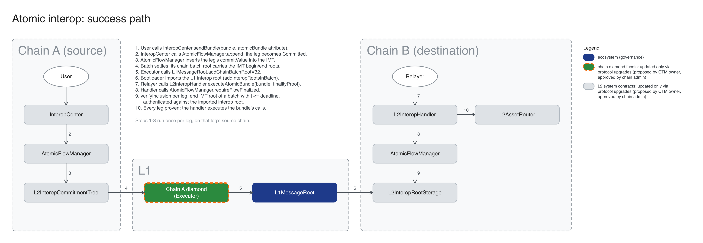

# The atomic flow: lifecycle and the flow manager

This page follows one atomic flow from send to finalize (or timeout), and documents the
`AtomicFlowManager` — the L2 built-in at `0x10014` that orchestrates every step and holds each leg's
state. The proof mechanics invoked in steps 3–4 live in {protocol-docs/atomicity/proofs.md}; the refund
in {protocol-docs/atomicity/recovery.md}; the interop-side send/execute wiring in
{protocol-docs/interop.md#atomic-bundles}.

## Data structures

All defined in `atomic-interop/IAtomicInterop.sol` unless noted.

| Type                  | Purpose                                                                                                                                                                                                                                                                                                                                                                                                                                 |
| --------------------- | --------------------------------------------------------------------------------------------------------------------------------------------------------------------------------------------------------------------------------------------------------------------------------------------------------------------------------------------------------------------------------------------------------------------------------------- |
| `AtomicFlowPreimage`  | The hashed field set that defines a flow: `version` (a `bytes1` format tag), `deadline` (a settlement-layer timestamp), `settlementLayerChainId`, `legBundleHashes[]`, `legChainIds[]` (sources), `legDestinationChainIds[]` (destinations; empty in a source-only flow, whose `flowId` hashes only the other five fields as `AtomicFlowPreimageV35`).                                                                                  |
| `AtomicFlow`          | `{ flowId, preimage }`. `flowId` is always recomputed from `preimage` and matched before use, so it is a convenience field, never a trust anchor.                                                                                                                                                                                                                                                                                       |
| `ImtProof`            | One IMT proof against a source chain's commitment tree — used for both inclusion (finality) and non-inclusion (timeout). See below and proofs.md.                                                                                                                                                                                                                                                                                       |
| `AtomicFinalityProof` | `{ flow, proofs[] }` — the flow definition plus one inclusion proof per commitment: per leg in a source-only flow, per participating chain in an accepted flow ([acceptance.md](./acceptance.md#commitments)), in that order. The whole thing a destination needs to execute.                                                                                                                                                           |
| `LegState`            | Per-`(flowId, bundleHash)` lifecycle of a leg on this chain: `Unset -> Committed -> Revertable -> Reverted` for a leg it sends, `Unset -> Accepted` for one it receives. See [the machine](#legstate-machine).                                                                                                                                                                                                                          |
| `AtomicSend`          | Out-of-band send metadata (`interop/IInteropCenter.sol`): `{ flowPreimage, lowNullifierIndex, isAtomic }`, parsed from the `atomicBundle` ERC-7786 attribute by `InteropAttributeParser.parseAtomicSend`. `isAtomic` is simply "the attribute was present" — the `InteropCenter` requires it for every L2->L2 send and forbids it for an L2->L1 withdrawal. Never enters the bundle, so `bundleHash` stays independent of the preimage. |

### The preimage `version`

`AtomicFlowPreimage.version` is a `bytes1` format tag, following the same convention as
`INTEROP_BUNDLE_VERSION` / `INTEROP_CALL_VERSION`. Finality and refunds accept
`ATOMIC_FLOW_PREIMAGE_VERSION_SOURCE_ONLY` (`0x01`) and `ATOMIC_FLOW_PREIMAGE_VERSION_ACCEPTED` (`0x02`, see
{protocol-docs/atomicity/acceptance.md}); `append` and `accept` take `0x02` only, so no new source-only flow can be
started. Anything else reverts with `ManagerFlowPreimageVersionMismatch`.
Because `version` is a hashed field, a preimage of one version can never collide with — or be
reinterpreted under the rules of — another. A new value is introduced whenever the field set or its
canonicalization changes. Introducing one stops new sends of the old, but finality and refunds keep accepting
every version that may still be in flight. A source-only flow with all legs sent can still finalize.
A source-only flow with legs unsent at the upgrade can only time out and refund.

### `legBundleHashes` vs the chain ids

`legBundleHashes` is **strictly ascending** — it is the canonical, deduplicated set of legs, and its
ordering is what makes `flowId` canonical (any permutation would hash differently). `legChainIds` and
`legDestinationChainIds` are **positional**: entry `i` is the source, respectively the destination, chain of leg
`i`, aligned 1:1 with `legBundleHashes` (a source-only flow has no destinations, see
{protocol-docs/atomicity/acceptance.md#commitments}). They may repeat and need not be sorted, so only their
lengths are validated, plus, in an accepted flow, that no leg goes from a chain to itself
(`ManagerLegFromChainToItself`): such a leg could never be sent, and since acceptance does not authenticate a
bundle's source, it would let anyone record a forged bundle as the chain's own send. They are deliberately _not_ sets: if they were, a sibling chain present in the set could
authorize a wrong-chain refund (see the source-chain binding in {protocol-docs/atomicity/recovery.md} and
proofs.md).

### `ImtProof`, briefly

`ImtProof` carries two nested authentications: `settlementProof` proves the claimed `chainImtRoot` is a
specific chain's batch begin/end IMT leaf inside an imported interop root, and `imtProof` proves the
leaf under `chainImtRoot`. The batch's `l1Timestamp` is **not** a struct field — it would be spoofable;
it is read from the verified `settlementProof` words (it is folded into the chain batch leaf). `provesAgainstBeginRoot`
is a bool (not a raw leaf index) selecting the timeout branch, so authentication can never be aimed at
the logs/multichain leaves. Full mechanics in {protocol-docs/atomicity/proofs.md}.

## Lifecycle

The diagram shows a pre-v36 source-only flow (`0x01`). In v36, new flows use `0x02` and need participation
from every chain before finality.

### 1. Atomic send (append)

The source burn flows through the normal `initiateIndirectCall` / `L2AssetRouter` path; instead of
publishing the bundle to L1, `InteropCenter` calls `AtomicFlowManager.append(bundleHash,
destinationChainId, lowNullifierIndex, preimage)`. `append`:

1. **Recomputes and validates `flowId`** from the preimage (`_validateAndComputeFlowId`): `version`
   manager-supported (`ManagerFlowPreimageVersionMismatch`), at most `MAX_ATOMIC_FLOW_LEGS` (8) legs
   (`ManagerTooManyLegs` — appending is cheap, but finalization verifies one Merkle proof per commitment),
   `legBundleHashes` strictly ascending, both chain id arrays of matching length. Then it requires `0x02`: no
   new source-only flow can be started.
2. **Requires L1 settlement** (`_checkSettlementLayerIsL1`) — this release anchors proofs only on the L1
   message root (see {protocol-docs/atomicity/security.md#trust-assumptions}).
3. **Rejects flows whose deadline verifiably passed** (`ManagerFlowDeadlinePassed`): if a
   settlement-layer root with creation timestamp `> deadline` has been imported on this chain (tracked
   as a monotone maximum by `L2InteropRootStorage.latestInteropRootTimestamp`), the flow can already be
   timed out, so committing would only burn funds into a flow that must be refunded. Best effort as an
   expired-flow guard (imported roots lag the SL clock); what it enforces unconditionally is ordering:
   once a leg of the flow was reverted on this chain, no new leg can ever be committed here.
4. **Requires every chain of the flow, each leg's source and destination, to pass this chain's receive
   filter** (`ManagerLegChainNotAllowed`, {protocol-docs/interop-gating.md#receive-filter}): the chain must
   verify every chain's participation to execute or refund the flow. An allowed peer has a batch in L1's
   message root, without which its commitment could never be proven present _or_ absent and the flow would be
   stranded (see {protocol-docs/atomicity/security.md#timeout-protocol-preconditions}). This also rejects L1,
   which is never an allowed peer.
5. **Requires the committing bundle to be one of the legs** (`ManagerBundleNotInFlow`), declared with **this**
   chain as its source (`ManagerCommittedLegSourceChainMismatch`) and the bundle's destination as its destination
   (`ManagerCommittedLegDestinationChainMismatch`). A wrong or stale preimage — e.g. an off-chain
   bundle-hash prediction invalidated by an encoding change — reverts the whole send, burn included,
   rather than committing a leg under a `flowId` that could neither finalize nor be refunded.
6. **Marks the leg `Committed`** — rejecting a second step on the same `(flowId, bundleHash)` with
   `ManagerLegAlreadyRecorded` — and emits `FlowLegCommitted(flowId, bundleHash)`. If this was the chain's last
   local step ([acceptance](./acceptance.md#accepting-a-leg)), it then **inserts** the chain's participation
   value into its `L2InteropCommitmentTree`, emitting `FlowParticipated(flowId, deadline, leafIndex)`. The tree
   additionally mirrors the inserted value into an L2->L1 log for data availability (see
   {protocol-docs/atomicity/imt.md} and {protocol-docs/atomicity/security.md#data-availability}).

### Destination acceptance

For a new flow, relay each sent bundle and its preimage to its destination. Anyone can call
[`acceptAtomicBundle`](./acceptance.md#accepting-a-leg) there. Each participating chain inserts its IMT value
when all its outgoing legs are committed and all its incoming legs are accepted.

### 2. Root settlement + import

Covered by the interop-root channel — see {protocol-docs/atomicity/imt.md#the-root-is-read-from-storage-never-published}
and {protocol-docs/message-root.md#interop-root-import-and-the-batch-execution-double-check}. Nothing
atomic-specific happens here; the same channel carries all interop roots.

### 3. Finalize — `requireFlowFinalized`

`InteropHandler.executeAtomicBundle(bundle, finality)` calls `requireFlowFinalized(executingBundleHash,
finality)`, which:

- re-checks `flowId` and L1 settlement;
- requires exactly one proof per commitment (`ManagerProofCountMismatch`): per leg in a source-only flow, per
  participating chain in an accepted flow ({protocol-docs/atomicity/acceptance.md#commitments});
- for **every** commitment, checks the proof's `sourceChainId` equals the commitment's chain (the leg's
  declared source, or the participating chain), that this chain accepts that chain
  ({protocol-docs/interop-gating.md#receive-filter}), and runs `AtomicInteropProof.verifyInclusion` against
  the commitment value (the leg's `commitValue` or the chain's participation value), the flow `deadline`, and
  the settlement layer;
- requires the executing bundle to be one of the legs (`ManagerExecutingBundleNotInFlow`).

If every commitment is proven in time, the handler executes the bundle's calls (the destination
mint). The per-proof chain check is defense-in-depth here (inclusion self-binds via the chain-specific
commitment value) but load-bearing on the refund path. `verifyAtomicBundle` is a mint-free
variant that runs the same gate and only records verification (`BundleStatus.Verified`); a subsequent
`executeAtomicBundle` then skips the gate, since the proof was already spent. `receiveMessage` can route
to either.

### 4. Timeout / refund

If a commitment is missing at the deadline, `authorizeRefund` takes one absence proof and flips this chain's
`Committed` legs to `Revertable`; `claimRefund` then _attempts_ to reverse the recoverable burns — it
succeeds as long as no attempted recovery reverts (a claim that recovers nothing still consumes the
leg). Detailed in
{protocol-docs/atomicity/recovery.md}; the absence-proof conditions in
{protocol-docs/atomicity/proofs.md#timeout}.

## The `AtomicFlowManager`

The manager is the only stateful atomic contract. Its state is `_state[flowId][bundleHash] => LegState`; it holds
no funds and no configuration beyond the L1 chain id recorded at `initL2`.

### Entry points

| Function                                                              | Caller            | Effect                                                                                           |
| --------------------------------------------------------------------- | ----------------- | ------------------------------------------------------------------------------------------------ |
| `append(bundleHash, destinationChainId, lowNullifierIndex, preimage)` | `InteropCenter`   | Validate + commit a leg (step 1). `Unset -> Committed`.                                          |
| `accept(bundleHash, sourceChainId, lowNullifierIndex, preimage)`      | `InteropHandler`  | Record this chain's acceptance of a leg. `Unset -> Accepted`. See acceptance.md.                 |
| `requireFlowFinalized(bundleHash, finality)`                          | `InteropHandler`  | `view`. Prove every commitment in time (step 3). No state change.                                |
| `authorizeRefund(flow, missingLegIndex, absence)`                     | anyone            | Prove a commitment absent past the deadline; flip this chain's `Committed` legs `-> Revertable`. |
| `claimRefund(flowId, bundle)`                                         | anyone            | Reverse a `Revertable` leg's burn; `-> Reverted`. See recovery.md.                               |
| `legState(flowId, bundleHash)`                                        | anyone            | `view` accessor.                                                                                 |
| `initL2(l1ChainId)`                                                   | `ComplexUpgrader` | One-time genesis wiring: records `L1_CHAIN_ID`. Rejects a zero id and a second call.             |

`append` is gated to the canonical `InteropCenter`, `accept` and `requireFlowFinalized` to the `InteropHandler`
addresses (`onlyInteropCenter` / `onlyInteropHandler`, reverting `ManagerNotInteropCenter` /
`ManagerNotInteropHandler`); both addresses come from the `interopCenter()` / `interopHandler()` constant
getters, so there is nothing to configure. `initL2` is `onlyUpgrader`. `authorizeRefund` and
`claimRefund` are permissionless — they are pure proof-and-effect functions; anyone may push a timed-out
flow forward, and neither can do anything a proof does not authorize.

### `LegState` machine

`Unset -> Committed` at send on the source, `Unset -> Accepted` at acceptance on the destination; each chain
records one step per leg (`ManagerLegAlreadyRecorded`). On the happy path both are terminal in the manager —
destination execution is tracked by the `InteropHandler`'s own `bundleStatus`, exactly as for a normal interop
bundle, not here. On timeout, `Committed -> Revertable` (`authorizeRefund`) `-> Reverted` (`claimRefund`);
`Accepted` legs are not touched, as the refund belongs to the source.
`claimRefund` requires `Revertable` and flips to `Reverted` **before** any external call (CEI), so a
reentrant claim hits the state check and cannot double-refund; the manager needs no reentrancy guard
because it never holds funds.

### `flowId` canonicalization is shared

`_validateAndComputeFlowId` is called by **both** the local steps (`append`, `accept`) and `_checkFlowId`
(finalize/refund), so the canonical shape (`flowId = keccak256(abi.encode(preimage))`, or of its first five
fields for `0x01`; supported `version`, ascending leg
hashes, aligned chain ids) cannot drift between the path that commits a leg and the path that later
spends the proof. Any mismatch reverts (`ManagerFlowIdMismatch`, `ManagerFlowPreimageVersionMismatch`,
`ManagerBundleHashesNotSorted`, `ManagerLegChainIdsLengthMismatch`, `ManagerLegDestinationChainIdsLengthMismatch`).
