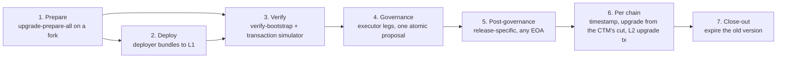

# Upgrading an ecosystem

This document describes the pipeline that takes an existing ecosystem from one protocol release to
the next: the artifacts a release consists of, the phases in which they are deployed, verified,
approved and applied, who signs each phase, and how a release's scripts are structured. The
on-chain upgrade mechanism itself (how the CTM publishes a version and how a chain applies it) is
specified in [Protocol upgrade process](./system/contracts/chain_management/upgrade_process.md),
the upgrade model (write-once release and transition objects, the executors, the governance
calls) in [docs/registry-driven-upgrades.md](../docs/registry-driven-upgrades.md), what those calls
do and in which order in [Ecosystem upgrade coordination](./ecosystem-upgrade-coordination.md), and
the commands in
the [upgrade runbook](../l1-contracts/deploy-scripts/upgrade/README.md); the one-time migrations of
the current release are listed in
[Upgrading an existing ecosystem onto this release](./chain-lifecycle.md#upgrading-an-existing-ecosystem-onto-this-release).
Deploying an ecosystem from scratch is covered by
[Deploying a new ecosystem](./ecosystem-deployment.md).

The pipeline is the same whichever organization runs the ecosystem, but today the tooling does not
yet cover a private ecosystem end to end:

- the `protocol_ops` commands that resolve the L1 network from its chain id (`ctm init`,
  `ecosystem init`, and `upgrade-prepare-all` without `--env`) refuse any L1 other than mainnet,
  Sepolia, Holesky or a local Anvil;
- the governance bundle is executed differently by a legacy `Governance` and by a
  `ProtocolUpgradeHandler` (see "The governance call").

## What a release changes

A protocol release is the combination of:

- **new L1 implementations** for the ecosystem proxies (Bridgehub, chain asset handler, message
  root, nullifier, asset router, native token vault, interop handler, CTM deployment tracker, chain
  registration sender) and for the CTM-domain proxies (`ChainTypeManager`, `ValidatorTimelock`,
  `BytecodesSupplier`, `PermissionlessValidator`, `ServerNotifier`), each deployed only when the
  release changes it: an implementation that already runs the code the current sources produce is
  reused. The core ones become rows of a Core-domain `ProxyUpgradeTransition`, the CTM-domain ones
  rows of a CTM-domain one;
- **a new chain version**: a write-once `CTMRelease` naming the diamond facets, `DiamondInit`, the
  verifier, the genesis upgrade and the L2 description, and a `CTMTransition` from the departing
  release to it, which derives the facet cuts and the L2 upgrade transaction (force deployments of
  the changed L2 built-ins plus the L2 upgrade call) every chain applies. Committing the transition
  also makes the new release the CTM's `currentRelease`, so chains created after the upgrade come up
  directly on the new version with the same genesis as the upgraded ones;
- **release-specific one-time work**: new proxies, wiring calls, storage migrations, and
  post-governance steps that a from-scratch deployment gets for free. Any governance or admin call
  beyond the upgrade itself is a declared external action of the prepare output.

The objects and their rules are described in
[docs/registry-driven-upgrades.md](../docs/registry-driven-upgrades.md#objects).

The invariant behind all of it is that an upgraded ecosystem and a freshly deployed one end up in
the same state; the release-specific work is exactly the difference between the two. The
genesis-versus-upgrade consistency rules are spelled out in
`docs/ai-review/docs/genesis-and-upgrades.md`.

## Roles

| Role                 | Who                                                                                                                                                                                                                                              | Signs                                                                                                                                               |
| -------------------- | ------------------------------------------------------------------------------------------------------------------------------------------------------------------------------------------------------------------------------------------------ | --------------------------------------------------------------------------------------------------------------------------------------------------- |
| Deployer             | any funded EOA                                                                                                                                                                                                                                   | the CREATE2 deployments (implementations and the write-once objects) and bytecode publication                                                       |
| Post-governance      | any funded EOA (not necessarily the deployer)                                                                                                                                                                                                    | release-specific post-governance steps, if the release has any (v34 has none)                                                                       |
| Ecosystem governance | the owner of the upgrade executors, which own the core and CTM-domain `ProxyAdmin`s and the CTMs (before the v35 bootstrap edge, governance owns those directly); `ProtocolUpgradeHandler` on the public ecosystems, `Governance` on a fresh one | the one governance bundle: the executor legs (`applyL1Upgrade`, `applyInfrastructureUpgrade`, `applyCTMUpgrade`) plus the declared external actions |
| CTM admin            | the CTM's `ChainAdmin`                                                                                                                                                                                                                           | operational CTM-side calls emitted by the prepare (on the v35 bootstrap edge, its half of the `ServerNotifier` handover, `[ctm_admin_calls]`)       |
| Chain admin          | each chain's `ChainAdmin`                                                                                                                                                                                                                        | the chain's upgrade timestamp and the call that applies the cut the CTM serves                                                                      |
| Chain operator       | the node                                                                                                                                                                                                                                         | nothing on L1; executes the L2 upgrade transaction in the next batch                                                                                |

Deployments by the deployer are inert: nothing it deploys changes anything until governance
applies the objects that name it. What the deployer deployed is reviewed through the objects'
manifests and their provenance (which is what the verification phase checks); what governance
signs is the executor legs and the declared external actions.

## Artifacts and inputs

| Path                                                              | Role                                                                                                                                                                                                                                                |
| ----------------------------------------------------------------- | --------------------------------------------------------------------------------------------------------------------------------------------------------------------------------------------------------------------------------------------------- |
| the release branch's build artifacts                              | built with the default Foundry profile (`yarn l1 build:foundry`); the deployed bytecode                                                                                                                                                             |
| `AllContractsHashes.json`                                         | the registry of every contract's bytecode hashes; verification holds creation and runtime code against it, so it must be regenerated with the release                                                                                               |
| `SystemConfig.json`                                               | the system and fee constants (batch overhead, pubdata and L1 transaction gas parameters) the scripts read                                                                                                                                           |
| `configs/genesis/<vm>/latest.json`                                | the target protocol version and the chain creation parameters (genesis root, initial contracts) of the release                                                                                                                                      |
| `l1-contracts/upgrade-envs/permanent-values/<env>.toml`           | the environment's fact sheet: L1 chain id, Bridgehub, CTMs (with VM type), governance kind, testnet-verifier flag, ZK token asset id; independent of the release                                                                                    |
| `l1-contracts/upgrade-envs/<release>/<env>.toml`                  | the release × environment input: owner, Era chain id, CREATE2 salts, the release's one-off switches; `protocol_ops --env <env>` reads both files                                                                                                    |
| `l1-contracts/upgrade-envs/<release>/output/<env>/ecosystem.toml` | **the artifact**: every new address, the objects (`[core.registry]`, `[ctms.*.registry]`), the one governance bundle (`[governance_calls] calls`) and the declared `[[external_actions]]`; what reviewers diff and what every downstream tool reads |
| `…/output/<env>/transactions.txt`                                 | the L1 transaction hashes of the deployer's broadcast, appended on every run; an operational record that verification does not read                                                                                                                 |
| `…/output/<env>/extra-verification-logs.txt`                      | one `forge verify-contract` line per deployed contract, constructor arguments included                                                                                                                                                              |
| `…/output/<env>/sim-inputs/`, `…/simulator/`                      | the transaction-simulator inputs and scenarios                                                                                                                                                                                                      |
| `…/output/<env>/chain-upgrades/<chain-id>/`                       | the per-chain bundles                                                                                                                                                                                                                               |
| `…/output/<env>/prepare/`                                         | git-ignored: the per-run Safe bundles and `manifest.json` the prepare emits                                                                                                                                                                         |

Everything else (CTM addresses, bytecodes supplier, DA manager, chain admins, verifier, and the old
protocol version, which the CTM script reads from the CTM) is read from L1 at run time rather than
configured; `docs/ai-review/docs/protocol-ops.md` explains why the
tooling is built that way.

## The pipeline

| Phase              | `protocol_ops` command                                                                                    | Signer               | Touches the real L1 |
| ------------------ | --------------------------------------------------------------------------------------------------------- | -------------------- | ------------------- |
| 1. Prepare         | `ecosystem upgrade-prepare-all`                                                                           | none (fork)          | no                  |
| 2. Deploy          | `ecosystem upgrade-broadcast`                                                                             | deployer, CTM admin  | yes                 |
| 3. Verify          | `ecosystem verify-bootstrap`, `ecosystem governance-toml-to-simulator`, `ecosystem manifest-to-simulator` | none                 | no                  |
| 4. Governance      | `ecosystem upgrade-governance` or the governance's own proposal flow                                      | ecosystem governance | yes                 |
| 5. Post-governance | release-specific, if any (none in v34)                                                                    | any EOA              | yes                 |
| 6. Per chain       | `chain set-upgrade-timestamp`, `chain upgrade` (emit bundles)                                             | each chain admin     | yes                 |
| 7. Close-out       | `ChainTypeManager.setProtocolVersionDeadline` through `CTMUpgradeExecutor.forward`                        | ecosystem governance | yes                 |

Only `upgrade-broadcast` sends transactions. The verify commands only read; every other
`protocol_ops` command in the table runs on an Anvil fork and writes Safe bundles, and a phase
touches L1 when its signer executes those bundles (with `upgrade-broadcast`, `dev execute-safe`,
or the signer's multisig).

The `generate-upgrade-calldata-*` workflows and the per-chain
`generate-chain-{add-validator,remove-validator,set-upgrade-timestamp,upgrade}-calldata` workflows
under `.github/workflows/` still drive the previous `protocol_ops` CLI (`--ecosystem`,
`--chain <name>`, `--governance-toml-out`, `--new-protocol-version`, none of which exist any more)
and have to be updated before they can run these phases; until then the commands are run by hand.
`generate-chain-init-calldata` and `execute-deployer-safe-bundles` already use the current flags,
but read the Bridgehub and the deployer from `environments/<env>/ecosystem.yaml`, which is
committed only for `stage-interop-tests` (with a placeholder deployer).

`protocol_ops ecosystem rehearse-upgrade --env <env>` chains the prepare, a replay of every bundle
on the fork and the upgrade's checks into one command and packs the deploy bundle;
`docs/ecosystem-upgrade-deploy.md` walks through it and the `generate-ecosystem-upgrade-calldata`
workflow that runs it in CI. The package check before a vote is `ecosystem verify-bootstrap`
(phase 3) in every case.

### 1. Prepare

`protocol_ops ecosystem upgrade-prepare-all --env <env> --l1-rpc-url <l1> --deployer-address <EOA>`
forks `<l1>` (without `--l1-rpc-url` it forks `http://localhost:8545`; `--env` does not fill it)
and runs, on that fork, the release's core script once (`CoreUpgrade_v<N>.noGovernancePrepare`)
and its CTM script once for the one CTM it targets (`CTMUpgrade_v<N>.noGovernancePrepare`; the
CTM comes from `--ctm-proxy`, `--ctm-config` or the env's `[[ctm_contracts.ctms]]`, and anything
but exactly one ZKsync OS CTM is refused). The bundles and `manifest.json` go to
`output/<env>/prepare/` (override with `--out`, which names the bundle directory itself;
`ecosystem.toml` is written to its parent). Together they:

1. deploy through CREATE2, with the salts of the release input, every implementation the release
   changes (one already running the code the current sources produce is reused), then the
   write-once objects: a Core-domain `ProxyUpgradeTransition`, the `CTMRelease`, the
   `CTMTransition` and a CTM-domain `ProxyUpgradeTransition`, each only when the release changes
   what it describes;
2. publish the new L2 bytecodes to the `BytecodesSupplier`; the transition derives the facet cuts
   and the L2 upgrade transaction (force deployments of the L2 built-ins plus the delegate call to
   the L2 upgrade contract) from the two releases when it is constructed;
3. build the release's genesis parameters from the genesis config;
4. merge everything into `ecosystem.toml` with one governance bundle: the merger's own extras, the
   executor legs derived from the objects the prepares report, and the calls each prepare declared
   as external actions (the runbook's "Prepare and compose" gives the order);
5. record every broadcast into Safe bundles, one per consecutive run of transactions by the same
   signer, with `manifest.json` listing them in execution order.

Two properties of the prepare decide whether the rest of the pipeline can work:

- **The build must be the default Foundry profile.** Verification re-derives each object's CREATE2
  address from creation code held against `AllContractsHashes.json`, and checks live runtime code
  against it; that file is generated under that profile, so a metadata-stripped build never matches
  and verifies nothing. The price is that the CREATE2 addresses embed path-dependent metadata, so a
  prepare re-run from another checkout yields different but equally valid addresses. The artifact
  is verified by re-deriving its addresses (phase 3), never by diffing them against one's own run.
- **Salts and the deployer are part of the result.** CREATE2 returns the previously deployed
  contract for a repeated `(salt, init code)` pair, so the salts in the release input are rotated
  before every regeneration; they are also verification inputs, since every address is re-derived
  under them. The deployer address is the `from` of the bundles it signs (and part of their file
  names), so the prepare is run with the EOA that will broadcast; it does not appear in any deployed
  contract's init code.

An ecosystem whose upgrade already executed cannot be re-prepared at the chain tip: the CTM script
refuses a CTM that is already on the new protocol version (a transition must depart from the CTM's
live version and release), and the CREATE2 targets are occupied. Pin the fork to a block before the
governance call instead.
`upgrade-prepare-all` has no fork-block flag: pin it with `rehearse-upgrade --fork-block`, or pass
an Anvil fork already pinned to that block as `--l1-rpc-url`.

### 2. Deploy

`protocol_ops ecosystem upgrade-broadcast --manifest <out>/prepare/manifest-deployer-only.json
--key <deployer>=<key> --l1-rpc-url <l1> --out <out>/sepolia-deploy-executed.json`, with `<out>`
the release's `output/<env>/` directory, sends the deployer's bundles to the real L1, one
transaction at a time, confirming each, and appends every mined hash to `<out>/transactions.txt`
(only when `--out` is given; the file is an operational record, which verification does not read).
It needs a `--key` for every signer in the manifest and refuses to send anything otherwise, so the
manifest is first filtered down to the deployer's bundles; the CTM admin's bundle (bootstrap edge
only) is handed to its signer, and the governance bundle is calldata in `ecosystem.toml`, not a Safe
bundle. The testnet README shows the filtering step.

A re-run is not fully idempotent: it skips CREATE2 deployments whose target already has code and
transactions that revert with one of a few known "already done" selectors, and the hashes are
written per bundle, so a bundle interrupted half-way loses the hashes of the transactions it had
already mined. Recover those from the explorer before re-running.

Then the deployed contracts are source-verified on the explorer with the `forge verify-contract`
lines of `extra-verification-logs.txt`, adding the `--chain` and explorer API key they leave out.

### 3. Verify

Three independent checks, all read-only:

- **Package verification** (`protocol_ops ecosystem verify-bootstrap --ecosystem-toml …
--l1-rpc-url … --env <env> --expected-governance-owner … --executor-record … --create2-salt …`,
  alias `verify-package`; the runbook's "Verify" has the full invocation) re-derives every
  object's CREATE2 address from the reviewed creation code and the arguments it was constructed with
  (for a write-once object, the manifest it serves), checks live runtime code against
  `AllContractsHashes.json`, holds the genesis data and L2 bytecode table of the release the edge
  installs against the reviewed `configs/genesis/zksync-os/latest.json` (its root, and the proxy,
  implementation slot and implementation code at each member's fixed address), checks the
  executors' bindings and the owner the upgrade is driven by, and checks that the governance calls
  carry the executor legs once, contiguous and in canonical order, and that every other call is a
  declared external action. It is mandatory before
  every vote; what it establishes and what it does not is
  [Provenance and validation](../docs/registry-driven-upgrades.md#provenance-and-validation).
- **The transaction simulator** (`matter-labs/transaction-simulator`) replays the governance call
  and the per-chain bundles against a fork of the L1 tip. `ecosystem governance-toml-to-simulator`
  and `ecosystem manifest-to-simulator` emit its scenarios. Because the fork starts from the tip,
  everything the deployer signs must already be on L1 (phase 2) and must not be in the scenario; the
  scenario carries only what the ecosystem's other signers will execute.
- **Review of `ecosystem.toml`** against the previous artifact and the release notes: the new
  addresses, each object's manifest (`getManifest()`, held to `manifestHash()`), the declared
  external actions, and the version numbers.

### 4. The governance call

Governance signs one bundle, `[governance_calls] calls` of `ecosystem.toml`. For a recurring upgrade
it is the executor legs — `CoreUpgradeExecutor.applyL1Upgrade`,
`CTMUpgradeExecutor.applyInfrastructureUpgrade`, `CTMUpgradeExecutor.applyCTMUpgrade`, each when
its object exists, in that order — plus the declared external actions (the merger's PUH wiring and
CTM `acceptOwnership` normalization, and whatever calls the release declared); on the v35
bootstrap edge it is the run the `RegistryBootstrapSequence` derives, ending with
`RegistryBootstrapMigration.validateApplied()`.

The bundle is one atomic transaction: the legs apply the ecosystem proxy rows, then the CTM-domain
rows, then `setNewVersionUpgradeFromTransition` (which commits the transition and installs the
target release as the CTM's `currentRelease`), each verifying what it applied; any failure reverts
the whole proposal. There are no stages and no delay between parts, and chain migrations are not
paused around it
([migration pauses are incident control](../docs/upgrade-operations.md#migration-pauses-are-incident-control)).
The semantics are specified in
[Ecosystem upgrade coordination](./ecosystem-upgrade-coordination.md#execution).
`ecosystem upgrade-governance` replays the bundle on a fork as governance, fails unless the fork is
left in the state the package describes ([Where each check lives](#where-each-check-lives)), and
emits the bundle as one Safe bundle; the simulator scenario is the other rehearsal.

How the calls are executed depends on the governance:

- a fresh ecosystem's `Governance` schedules and executes them as one operation
  (`AdminFunctions.governanceExecuteCalls`);
- the public ecosystems' `ProtocolUpgradeHandler` executes them as a proposal approved by the
  Security Council and Guardians, or through the emergency upgrade board
  (`l1-contracts/deploy-scripts/upgrade/EmergencyUpgradeCalldata.s.sol`; see "Emergency execution"
  in the [runbook](../l1-contracts/deploy-scripts/upgrade/README.md#emergency-execution)).

The transition commit is what changes the protocol: from then on every chain of the CTM that is on
exactly the departing version may cross (a chain further behind crosses the earlier transitions
first, which stay committed under their own departing versions), and every chain created afterwards
starts on the new release.

### 5. Release-specific post-governance steps

Some releases need work after governance and before the chains move, signed by any EOA because it
carries no privilege. v34 has none. v33's was `protocol_ops ecosystem stage3`, which populated
`L1NativeTokenVault.bridgedOut` (see
[Populating `bridgedOut` during an in-place upgrade](./bridging.md#populating-bridgedout-during-an-in-place-upgrade)).
Such steps are described in the release's output README and, being broadcasts rather than
calldata, are not covered by the verifier.

### 6. Per chain

Each chain crosses on its own, normally through its own `ChainAdmin`. The order below is the ZKsync
OS one (this release upgrades ZKsync OS chains only), and it matters because scheduling the upgrade
is the point of no return for the node. Both `chain` commands below only write a bundle
(`ChainAdmin.multicall`, signed by the `ChainAdmin` owner, or by the `AccessControlRestriction`'s
default admin when `--access-control-restriction` is passed); each step happens when that bundle is
executed on L1, and the timestamp bundle must be executed before the upgrade bundle. With `--env`,
`chain upgrade` writes its bundle to `output/<env>/chain-upgrades/<id>/` by default;
`chain set-upgrade-timestamp` writes one only when `--out` is given, and produces no bundle
otherwise.

1. **Check the cut's preconditions first.** The cut reverts unless they hold on the chain: the
   chain is on exactly the old version, the transition's `upgradeTimestamp` has passed, every
   committed batch has been executed (the release installs a new verifier, and batches awaiting
   proof under the old one would stop being provable; this is the one step 3 waits for), and, on a
   minor bump, the previous upgrade transaction has been consumed. The generic engine,
   `DefaultUpgrade`, adds no precondition of its own.
2. `protocol_ops chain set-upgrade-timestamp --env <env> --chain-id <id> --upgrade-timestamp <ts>
--l1-rpc-url <l1> --out <dir>` prepares the call to `ServerNotifier.setUpgradeTimestamp`, keyed on
   the chain's current version ([Upgrade scheduling](./upgrade-scheduling.md)); `1` means
   "immediately" (0 is rejected). On this event the node injects the L2 upgrade transaction into
   its next block (block N) and holds every later batch until the chain's L1 version moves, so the
   cut's preconditions must already hold: if the cut then reverts, the chain is stuck. Run after
   the cut, the call reverts (`CutDataForProtocolVersionNotAvailable`), since no transition is
   committed from the new version.
3. `tools/upgrade-readiness-checker` waits until the node has the upgrade transaction in block N
   and block N-1 is finalized, that is, every batch before the upgrade has been executed on L1. This
   is the signal that the L1 cut can be sent now, not that the upgrade is done.
4. `protocol_ops chain upgrade --env <env> --chain-id <id> --l1-rpc-url <l1>` emits a single
   `ChainAdmin.multicall` with `upgradeChainFromVersion(chainAddress, oldVersion)` and, when
   `--da-mode` is given, the DA validator pair and pubdata content the chain runs after the upgrade,
   in the same transaction so that the chain never commits a batch under a DA setup its new version
   does not settle. The bundle carries no cut: the chain reads it from its CTM
   (`upgradeCutForVersion`, derived from the committed transition). A chain that predates v35
   crosses the bootstrap edge through the legacy cut-taking entrypoint instead, which
   `AdminFunctions.upgradeChainFromCTM` selects (`UpgradeChainCall.requiresCut`). Governance can
   also cross a chain itself. A chain at v35 or later crosses with
   `CTMUpgradeExecutor.upgradeChain(transition, chainId)`, which only the executor's owner or the
   chain's own admin may call
   ([Flow: upgrading](../docs/registry-driven-upgrades.md#flow-upgrading)). A chain that predates
   v35 departs from a version committed through the legacy path, which has no transition, so
   governance hands it the committed cut (`RegistryBootstrapMigration.upgradeCut()` on the bootstrap
   edge) through `ChainTypeManager.upgradeChainFromVersion(chainId, oldVersion, cut)`, sent through
   `CTMUpgradeExecutor.forward`; the chain refuses a cut whose hash differs from the one its CTM
   committed, or a version other than its own.
5. The batch carrying the upgrade transaction is committed and executed under the new version: the
   built-ins are force-deployed and the L2 upgrade contract initializes them. The chain is on the
   new version for good once that batch has been executed on L1.

`protocol_ops` checks only one of the preconditions explicitly: `chain upgrade` refuses to leave a
validium-priced chain in an unrecommended DA state. Everything else is covered only by the fork
replay when the bundle is prepared, which reflects the chain's state at that moment.

### 7. Close-out

The transition is committed with no deadline on the old version (`type(uint256).max`). Once every
chain has upgraded, governance can expire the old version with
`ChainTypeManager.setProtocolVersionDeadline(oldVersion, timestamp)`, sent through
`CTMUpgradeExecutor.forward`, after which a chain still on it cannot commit batches until its
admin or governance crosses it. The timestamp must be nonzero: a stored 0 means unset, and a
version with a committed transition then falls back to the deadline that transition pinned (none by
default), so expiring it takes a past timestamp such as 1.
The committed artifacts (`ecosystem.toml`, `transactions.txt`, the scenarios, the per-chain
bundles) stay in the release's `output/<env>/` directory as the record of the rollout, and
`permanent-values/<env>.toml` is updated with any address the release moved.

## Where each check lives

A proposal executes days after its package was reviewed, and in between, state that governance
does not control can move. Each check of an upgrade therefore has a home, chosen by what it reads.
protocol-ops may run an on-chain check earlier, so a bad package fails at review rather than at
execution, but it never replaces it:

| Where                          | What it checks                                                                                                                                                                                                                                                                                                                                                                                                                                                                                                                                                                                                                                    |
| ------------------------------ | ------------------------------------------------------------------------------------------------------------------------------------------------------------------------------------------------------------------------------------------------------------------------------------------------------------------------------------------------------------------------------------------------------------------------------------------------------------------------------------------------------------------------------------------------------------------------------------------------------------------------------------------------- |
| The contracts, live state      | State at execution that can change after review, by governance or by someone else (the CTM admin, a ChainAdmin, validators, the permissionless `migrate` caller): proxy implementations and code at every row's `implNew`, before the first swap; the CTM's `currentRelease`, `protocolVersion` and `upgradeTransition`; bytecode publication; `serverNotifierAddress` and the notifier's CTM; on the bootstrap edge, who owns the CTM, both `ProxyAdmin`s, the notifier and the executors, with no nomination pending, and whether `migrate()` already ran; each chain's batch counters, routing and fee params                                  |
| The contracts, write-once      | Cheap construction invariants whose failure cannot be undone: the `VersionEdgeLib` edge rules; zero members, a zero genesis batch hash, an empty facet set, repeated facet rows or a wrong L2 table length in a release; a transition built over a release that does not `validate()`; zero, self-edge or duplicate rows, a wrong inventory length or no participating row in a proxy upgrade transition; zero bindings in an executor, a transition or the bootstrap edge; an ownerless executor (a zero initial owner; `renounceOwnership` reverts); code at every address bound into a release or transition when it is installed or committed |
| protocol-ops, before the vote  | The review-time facts (`verify-package`): code identity, CREATE2 provenance, each new member's construction from its `member_deployments` record with every constructor argument held by value (code identity masks them), the ZiSK Plonk backend against its pinned codehash, the manifest contents (zero row fields, self-edges, duplicate proxies, empty inventories), executor bindings (the contracts refuse these too; protocol-ops reports them before the vote), bundle order, the arriving release's `validate()` by `eth_call`, and bytecode publication as an early readiness check                                                    |
| protocol-ops, after the replay | The post-state `ecosystem upgrade-governance` finds on its fork: the CTM's version, release and committed transition, who holds the CTM domain and the notifier, the executors' owners, every row's proxy at its `implNew`                                                                                                                                                                                                                                                                                                                                                                                                                        |
| Tests                          | That the reviewed code is right, including its post-conditions within one transaction: the Foundry tests and the Anvil runners assert them, and the contracts never re-check them, except the bootstrap's `validateApplied()` and the executor's commit check                                                                                                                                                                                                                                                                                                                                                                                     |

Three rules decide where a check lives:

- **A write-once object checks its own shape before anything is built from it.** A release refuses
  zero members and repeated facet rows at construction. Its `validate()` runs before anything is
  derived from it or installed: in a transition's constructor, in the bootstrap's `validate()`, and
  when `ChainTypeManager._setCurrentRelease` installs it. It depends only on the code at the
  addresses it names, so its `eth_call` before the vote predicts the install. Once a release is
  installed, nothing validates it again: chain creation, and the `validate()` of a transition
  departing from it, rely on the install-time run.
- **A live check lives in the contract that owns the state.** The CTM, not an executor wrapper,
  checks a commit and a replacement, so a call sent through `forward` gets the same checks.
- **A check that guards a write stays where the write happens.** It runs there even when an
  earlier step already guarantees it (an object's constructor, `L2PlanLib.build`, protocol-ops),
  and even when a later statement would revert anyway. The earlier step sees only the genuine
  objects and reviewed bundles it was given, and the later revert fires after other writes, or
  without a name. This covers every zero-address or empty-input check on a write, a named code
  check (`RegistryTargetHasNoCode`) before a call into an object or a row's `implNew`, authority
  checks before a hand-over, and bounds whose violation halts a chain: at most
  `MAX_NEW_FACTORY_DEPS` factory dependencies, major version 0. A check is deleted only in four
  cases:
  - when the feature it guards is gone;
  - when the same check already runs in the same call;
  - when a strictly stronger check runs at the same point, before any write, such as
    `replaceUpgradeTransition` requiring `expected` to be the committed transition. The deletion
    names the check that replaced it;
  - when it would validate an installed release again (the first rule).

  The `ChainTypeManager`, close to the EIP-170 size limit, names no code check of its own: a
  release or transition it is handed without code fails the CTM's first call into it, without a
  name.

Only a check that guards no write may live off chain alone: a review-time fact, or a post-condition
of the same transaction. protocol-ops performing a check is never by itself a reason to delete its
on-chain copy.

## Authoring a release

The scripts under `l1-contracts/deploy-scripts/upgrade/` are split into what every release does
and what one release adds:

- `default-upgrade/DefaultCoreUpgrade.s.sol` and `DefaultCTMUpgrade.s.sol` are the
  version-independent prepare pipeline: they deploy or reuse each implementation by code identity,
  build the release and the transitions, and record every other call a version needs
  as a declared external action (`declareExternalAction`).
- `v<N>/CoreUpgrade_v<N>.s.sol` and `CTMUpgrade_v<N>.s.sol` override only what the release changes:
  the implementations it deploys (`deployNew*Contracts`), the release members it replaces
  (`changedReleaseMembers()`), its kind (`upgradeKind()`: a chain release or an
  infrastructure-only upgrade that moves no version), and its L2 side when L2 built-ins change
  (`authorL2Side`). `yarn new-release` creates them, together with the release's
  `upgrade-envs/<release>/` inputs, and moves protocol-ops' defaults to them.
- `AdminFunctions.s.sol` drives the per-chain crossing in `protocol_ops`;
  `default-upgrade/DefaultChainUpgrade.s.sol` is the legacy cut-taking leg the tests use.
- `SystemContractsProcessing.s.sol` is the list of L2 built-ins a release force-deploys or
  neutralizes; new ones also go into the genesis generator, so that upgraded and freshly created
  chains match.

The on-chain side is generic: a transition pins an upgrade engine (`DefaultUpgrade`, unless the
version script overrides `deployUsedUpgradeContract`, as v35's bootstrap edge does with
`BootstrapUpgrade`), and `l1-contracts/contracts/l2-upgrades/` holds `L2ComplexUpgrader`, which
executes the L2 upgrade transaction, and the L2 upgrade contracts. A release also regenerates the
genesis config and `AllContractsHashes.json`.

The steps, the rules preparation enforces and the tests every release ships with are in
"Preparing the scripts for a new upgrade" of the
[runbook](../l1-contracts/deploy-scripts/upgrade/README.md#preparing-the-scripts-for-a-new-upgrade).

## Emergency and verifier-only upgrades

- **Verifier-only.** There is no separate verifier-only path. A verifier rotation is a patch:
  deploy the verifier, publish a release that copies the departing one except that member, publish
  a patch transition (for example `0.35.0 -> 0.35.1`) with no L2 side, and execute it as an
  ordinary upgrade ("Patches" in
  [Rules enforced at construction](../docs/registry-driven-upgrades.md#rules-enforced-at-construction)).
  Chains cross it with `chain upgrade` like any other edge, but a patch carries no L2 upgrade
  transaction (`BaseZkSyncUpgrade` refuses one on a patch edge), so there is no upgrade batch to
  wait for and `upgrade-readiness-checker` does not apply. The ZKsync OS node switches its protocol
  version only on the chain's `UpgradeTimestampUpdated` event, so `chain set-upgrade-timestamp` is
  still needed. The cut still reverts (`NotAllBatchesExecuted`) unless every committed batch has
  been executed on L1. A minor bump without an L2 upgrade transaction has no working path on ZKsync
  OS today: for any minor bump the node expects an upgrade transaction.
- **Emergency.** Governance can freeze a chain (`freezeChain`, `unfreezeChain`) and execute an
  arbitrary cut for it (`ChainTypeManager.executeUpgrade(chainId, cut)`); both are CTM owner
  methods, reached through `CTMUpgradeExecutor.forward`
  ([authority matrix](../docs/registry-driven-upgrades.md#authority-matrix-after-bootstrap)), and the
  Bridgehub's owner may also freeze and unfreeze directly, which is how the Security Council's freeze
  reaches the chains ([freezing a chain](./ecosystem-upgrade-coordination.md#freezing-a-chain)). On a
  `ProtocolUpgradeHandler` ecosystem a prepared package can also run at once through the emergency
  upgrade board: `VerifyEmergencyUpgrade.s.sol` dry-runs it on a fork and
  `EmergencyUpgradeCalldata.s.sol` emits the approvals and the board call, and a fix outside a
  prepared package is a `CTMUpgradeExecutor.forward` call packaged the same way ("Emergency
  execution" in the [runbook](../l1-contracts/deploy-scripts/upgrade/README.md#emergency-execution)).
